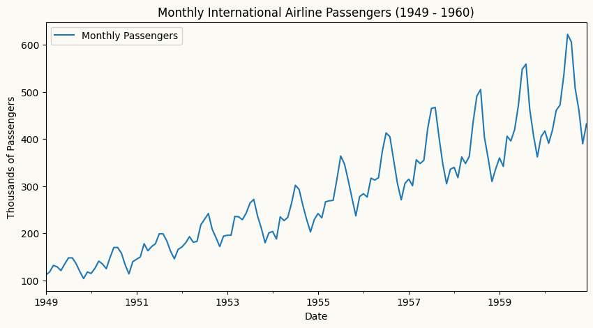
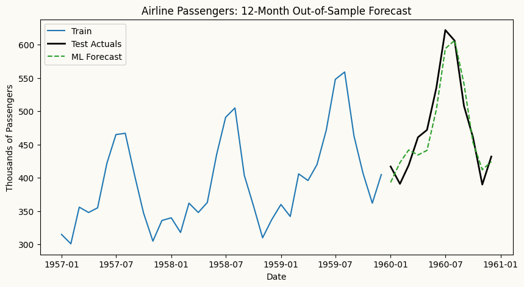

<!-- WARNING: THIS FILE WAS AUTOGENERATED! DO NOT EDIT! -->


[](https://pypi.org/project/peshbeen/)
[](https://pypi.org/project/peshbeen/)
[](https://github.com/mustafaslanCoto/peshbeen/blob/main/LICENSE)
[](https://pypistats.org/packages/peshbeen)
[](https://github.com/mustafaslanCoto/peshbeen/stargazers)

[](https://github.com/mustafaslanCoto/peshbeen/actions/workflows/test.yaml)
[](https://github.com/mustafaslanCoto/peshbeen/actions/workflows/deploy.yaml)
[](https://mustafaslanCoto.github.io/peshbeen/)
[](https://nbdev.fast.ai/)
[](https://github.com/mustafaslanCoto/peshbeen/commits/main)
[](https://github.com/mustafaslanCoto/peshbeen/issues)

> **One forecasting workflow. Many models. From classical statistics to
> machine learning, regime-switching, and probabilistic scenarios — all
> behind the same `.fit(df)` / `.forecast(H)` interface.**

**Peshbeen** is a Python forecasting library built around a single idea:
*the forecasting workflow should be the same regardless of the model.*
The name draws from Kurdish — *pesh* (“front”) and *been* (“to see”) —
combining to mean **foresight**.

Most forecasting libraries make you pick a lane: a classical-statistics
toolkit, an ML-regressor framework, or a deep-learning stack — each with
its own API, its own feature-engineering conventions, and its own way of
handling trends and uncertainty. Peshbeen instead puts an unusually wide
range of models behind **one** consistent interface, and bakes in the
parts of a real forecasting workflow — feature engineering, trend
handling, probabilistic scenarios, tuning, and model comparison — so
switching models is a one-line change, not a rewrite.

It spans naive baselines, **ETS**, **ARIMA**, **Auto ARIMA**, **Vector
Autoregression (VAR)**, scikit-learn regressors and gradient-boosted
trees (**XGBoost, LightGBM, CatBoost**), **TabPFN** tabular foundation
models, **Generalized Linear Models (GLM)** for count data,
**Markov-switching regime models (MS-ARR and MS-VAR)**, and a built-in
weighted ensemble
(**[`pesh`](https://mustafaslanCoto.github.io/peshbeen/modules/02_models/herne_pesh.html#pesh)**)
— for univariate *and* multivariate series.

## Why peshbeen?

Peshbeen is designed for the **messy middle** of real-world forecasting
— the projects where you need to try several very different model
families, account for structural breaks and regime changes, model counts
as well as continuous demand, and produce uncertainty you can actually
feed into a decision. Its advantages:

- **🔁 Switch models without rewriting your code.** A naive baseline, an
  ARIMA, a LightGBM regressor, a VAR, and a Markov-switching model all
  share the same `.fit` / `.forecast` / `.cross_validate` API. Comparing
  them fairly is a one-line change, not a new pipeline.

- **🌀 Regime-switching, built in.** First-class **Markov-switching**
  autoregressive
  ([`ms_arr`](https://mustafaslanCoto.github.io/peshbeen/modules/02_models/ms_arr.html#ms_arr))
  and VAR
  ([`ms_var`](https://mustafaslanCoto.github.io/peshbeen/modules/02_models/ms_var.html#ms_var))
  models capture regime changes — crisis vs. baseline demand,
  pre/post-intervention — that ARIMA and standard ML models smooth over.
  These sit behind the same interface as every other model.

- **📈 A unified trend / stationarity pipeline across *all* model
  families.** Differencing, a global linear trend, a local ETS trend, or
  **piecewise-linear detrending with explicit change points** is a
  single model argument — and it behaves identically whether you’re
  running ARIMA, a GLM, gradient boosting, or a regime-switching model.
  No rebuilding a transformer pipeline per model.

- **🔗 Multivariate forecasting with per-series control.**
  [`var`](https://mustafaslanCoto.github.io/peshbeen/modules/02_models/var.html#var)
  and
  [`ms_var`](https://mustafaslanCoto.github.io/peshbeen/modules/02_models/ms_var.html#ms_var)
  accept a **dictionary of lags (and transformations) per target
  series**, so each series can carry its own temporal structure while
  you still model their interdependencies.

- **🎲 Probabilistic *scenarios*, not just intervals.** Generate full
  sample paths for **any** model via residual calibration — empirical
  bootstrap, KDE, or a **correlated (block) bootstrap** that preserves
  dependence across horizons — ready to drop into capacity-planning or
  queueing simulations. Conformal prediction is available when you only
  need calibrated intervals.

- **🔢 Counts as a first-class case.** A statsmodels-backed **GLM** with
  a proper `family` (e.g. `sm.families.Poisson()`, Gamma) handles count
  data — admissions, calls, demand — directly, with AIC/BIC/HQC
  reported.

- **🧰 Batteries included.** Automatic lag and rolling/expanding feature
  generation, Box-Cox stabilisation, Optuna tuning, forward/backward
  feature selection, a built-in metric-optimised ensemble
  ([`pesh`](https://mustafaslanCoto.github.io/peshbeen/modules/02_models/herne_pesh.html#pesh)),
  and ready-to-use datasets (including real healthcare operations
  series).

> **A note on what powers it.** Peshbeen combines native,
> dependency-free implementations — like its high-performance **native
> ARIMA** built on vectorized NumPy/SciPy digital filtering — with
> proven foundations like **statsmodels** for ETS/GLM. The value
> peshbeen adds is the *unified workflow* around them — plus genuinely
> original pieces like the Markov-switching models, the per-series
> multivariate specification, the shared change-point-aware detrending,
> and the
> [`pesh`](https://mustafaslanCoto.github.io/peshbeen/modules/02_models/herne_pesh.html#pesh)
> ensemble.

## Key Features

The advantages above, in detail:

- **Unified API:** Train any model using a simple `.fit(df)` and
  `.forecast(H)` workflow, eliminating the need for manual
  feature/target splitting.

- **Model Agnostic Across 14 Specialized Forecasters:** Supports a
  comprehensive spectrum of forecasting architectures under one unified
  `.fit` / `.forecast` API:

  - **Univariate Statistical & ML:**
    [`naive`](https://mustafaslanCoto.github.io/peshbeen/modules/02_models/naive.html#naive),
    [`ets`](https://mustafaslanCoto.github.io/peshbeen/modules/02_models/ets.html#ets),
    [`arima`](https://mustafaslanCoto.github.io/peshbeen/modules/02_models/arima.html#arima),
    `auto_arima` (stepwise automated order selection),
    [`ml_forecaster`](https://mustafaslanCoto.github.io/peshbeen/modules/02_models/ml_forecast.html#ml_forecaster)
    (recursive),
    [`ml_direct_forecaster`](https://mustafaslanCoto.github.io/peshbeen/modules/02_models/direct_ml.html#ml_direct_forecaster)
    (horizon-specific direct multi-step),
    [`glm`](https://mustafaslanCoto.github.io/peshbeen/modules/02_models/glm.html#glm)
    (Poisson/Gamma count data), and
    [`ms_arr`](https://mustafaslanCoto.github.io/peshbeen/modules/02_models/ms_arr.html#ms_arr)
    (Markov-switching autoregressive regime changes).
  - **Wide Multivariate Models:**
    [`ml_multi_output_forecaster`](https://mustafaslanCoto.github.io/peshbeen/modules/02_models/multi_output.html#ml_multi_output_forecaster),
    [`var`](https://mustafaslanCoto.github.io/peshbeen/modules/02_models/var.html#var),
    and
    [`ms_var`](https://mustafaslanCoto.github.io/peshbeen/modules/02_models/ms_var.html#ms_var)
    for modeling simultaneous dynamical feedback and cross-series lag
    interactions across wide DataFrames with multiple target columns.
  - **Multi-Series Panel Models:**
    [`panel_forecaster`](https://mustafaslanCoto.github.io/peshbeen/modules/02_models/panel_forecast.html#panel_forecaster)
    (scalable pooled global ML models across long panel series) and
    [`ml_multi_forecaster`](https://mustafaslanCoto.github.io/peshbeen/modules/02_models/ml_multi_forecast.html#ml_multi_forecaster)
    (pooled multi-series models with cross-series lag
    interdependencies).
  - **Ensemble:**
    [`pesh`](https://mustafaslanCoto.github.io/peshbeen/modules/02_models/herne_pesh.html#pesh)
    (combines arbitrary member models with metric-optimized weights via
    cross-validation).

- **Automatic Feature Engineering:** User can specify the key following
  parameters to automatically generate features:

  - `lags`: List of lag periods to create lag features.
  - `rolling_windows`: List of window sizes for rolling statistics to
    create rolling features (e.g., rolling mean, rolling std, rolling
    quantiles).
  - `trend removal`: Option to automatically difference the data or
    de-trend it using global trend, local trend, or piecewise linear
    trend. For piecewise linear trend, the user can specify the indexes
    of the breakpoints. For local trend, the user can pass ETS
    parameters to fit a local ETS model and use its fitted values as the
    local trend.
  - `boxcox`: Option to apply Box-Cox transformation to target variable
    to stabilize variance.

- **Multivariate & Multi-Series Forecasting:** Built-in support for both
  wide multivariate systems and pooled multi-series panels:

  - *Wide Multivariate
    ([`ml_multi_output_forecaster`](https://mustafaslanCoto.github.io/peshbeen/modules/02_models/multi_output.html#ml_multi_output_forecaster),
    [`var`](https://mustafaslanCoto.github.io/peshbeen/modules/02_models/var.html#var),
    [`ms_var`](https://mustafaslanCoto.github.io/peshbeen/modules/02_models/ms_var.html#ms_var)):*
    Expects wide DataFrames where columns share synchronous timestamps.
    Directly models contemporaneous feedback and cross-variable lag
    interactions between interacting series.
  - *Pooled Multi-Series Panel
    ([`panel_forecaster`](https://mustafaslanCoto.github.io/peshbeen/modules/02_models/panel_forecast.html#panel_forecaster),
    [`ml_multi_forecaster`](https://mustafaslanCoto.github.io/peshbeen/modules/02_models/ml_multi_forecast.html#ml_multi_forecaster)):*
    Expects long panel DataFrames (`id_col`, `target_col`).
    [`panel_forecaster`](https://mustafaslanCoto.github.io/peshbeen/modules/02_models/panel_forecast.html#panel_forecaster)
    pools data across hundreds or thousands of series to learn shared
    dynamics without cross-series lag bloat;
    [`ml_multi_forecaster`](https://mustafaslanCoto.github.io/peshbeen/modules/02_models/ml_multi_forecast.html#ml_multi_forecaster)
    allows explicit cross-series lag dependencies.

- **Probabilistic Forecasting:** Enables probabilistic forecasting
  through a simple two-step workflow. First, call `calibrate` with a
  held-out portion (calibration data) of your dataset — peshbeen uses
  the residuals at each horizon to fit the uncertainty model. Then call
  `sample` to generate forecast scenarios and prediction intervals,
  giving you a full picture of forecast uncertainty for risk assessment
  and decision-making.

  Four methods are implemented for generating probabilistic forecasts:

  - **Empirical bootstrap:** Resamples from the empirical distribution
    of the residuals and adds the resampled residuals to the point
    forecasts, building a distribution of possible future values
    (`method="empirical"`).

  - **Kernel Density Estimation (KDE):** Fits a smooth probability
    density to the residuals and samples from it, which can capture
    non-normal or heteroscedastic residual structure better than plain
    resampling (`method="kde"`).

  - **Correlated (block) bootstrap:** Resamples entire rows of residuals
    (all horizons together), preserving the temporal dependencies and
    correlations between forecast errors at different horizons for more
    realistic scenarios (`method="correlated"`).

  - **Conformal prediction:** Calculates nonconformity scores from the
    residuals on a calibration set and uses them to construct prediction
    intervals. This method produces intervals only (no scenario sample
    paths), and is accessed via `calibrate()` + `conformal_quantiles()`.

- **Hyperparameter Tuning & Feature Selection:** Built-in hyperparameter
  tuning with Optuna, plus forward/backward feature selection, so you
  can optimise both model configuration and the feature set with minimal
  effort.

- **Built-in Ensemble
  ([`pesh`](https://mustafaslanCoto.github.io/peshbeen/modules/02_models/herne_pesh.html#pesh)):**
  Combine any set of fitted models with equal weights, user-defined
  weights, or weights **optimised to minimise the metric you care
  about** via cross-validation.

- **Evaluation Metrics:** A metrics module covering MAE, MSE, RMSE,
  MAPE, SMAPE, WMAPE and the scaled metrics MASE, RMSSE and SRMSE for
  fair model comparison.

## When to reach for peshbeen

Peshbeen is the right tool when you want to **compare statistical, ML,
and regime-switching models with the same code**, when you suspect
**regime changes or structural breaks**, when you’re forecasting
**counts**, when your **multivariate** series need different lag
structures, or when you need **forecast scenarios** for downstream
simulation rather than just a point and an interval.

If your problem is dominated by **deep-learning / foundation models**,
or by fitting **thousands of series at maximum speed**, mature
specialised libraries (Darts, sktime, Nixtla) may serve you better — and
peshbeen happily wraps the same proven engines where it makes sense.
Peshbeen’s focus is *coherence across a wide model span and coverage of
an underserved middle*, not out-scaling any single category.

## Installation

Installation requires Python 3.10 or higher:

``` bash
pip install peshbeen
```

## Quick Start Example

``` python
from peshbeen.datasets import load_airline_passengers
from peshbeen.models import ml_forecaster
from peshbeen.transformations import rolling_mean, rolling_std
from lightgbm import LGBMRegressor

# Load clean monthly airline passenger data (1949 - 1960)
pax = load_airline_passengers()
train = pax[:-12]
test = pax[-12:]

# Automatic feature engineering: rolling statistics and seasonal lag structure
transforms = [rolling_mean(window_size=12, shift=1), rolling_std(window_size=12)]

# Machine learning forecaster with automated Box-Cox stabilization and linear detrending
model = ml_forecaster(
    model=LGBMRegressor(verbose=-1, random_state=42),
    target_col='passengers',
    lags=12,
    trend='linear',
    box_cox=True,
    lag_transform=transforms
)
model.fit(train)
forecasts = model.forecast(H=12)
```

``` python
import matplotlib.pyplot as plt
pax["passengers"].plot(figsize=(10, 5), label="Monthly Passengers", color="#1f77b4")
plt.title("Monthly International Airline Passengers (1949 - 1960)")
plt.xlabel("Date")
plt.ylabel("Thousands of Passengers")
plt.legend()
plt.show()
```



``` python
plt.figure(figsize=(10, 5))
plt.plot(train.index[-36:], train['passengers'][-36:], label='Train', color='#1f77b4')
plt.plot(test.index, test['passengers'], label='Test Actuals', color='black', linewidth=2)
plt.plot(test.index, forecasts, label='ML Forecast', color='#2ca02c', linestyle='--')
plt.title("Airline Passengers: 12-Month Out-of-Sample Forecast")
plt.xlabel("Date")
plt.ylabel("Thousands of Passengers")
plt.legend()
plt.show()
```



## Acknowledgements

Sincere thanks to the **[Data Lab for Social
Good](https://uk.linkedin.com/company/dlsg2023)** research group at
**Cardiff University, UK**, and its Director, **[Prof. Bahman
Rostami-Tabar](https://bahmanrostamitabar.github.io/)**, for their
support and encouragement during the development of this package.

<a href="https://uk.linkedin.com/company/dlsg2023">

</a>

## Developers

- **[Mustafa Aslan](https://mustafaslancoto.github.io/)**, PhD
  Researcher in Data Science and Operations Research in Healthcare
  Operations at Cardiff University.

Contributions, issues, and feature requests are welcome on the [GitHub
repository](https://github.com/mustafaslanCoto/peshbeen).

## References & Gratitude

Peshbeen would not exist without the valuable work of the respective
researchers and practitioners. The following references are the
foundation of this package — they shaped its methods, its design, and
the way it thinks about forecasting. I am deeply grateful to their
authors for making such clear, generous, and freely available
scholarship.

**Forecasting foundations**

- Hyndman, R.J., & Athanasopoulos, G. (2021). [*Forecasting: Principles
  and Practice* (3rd ed.)](https://otexts.com/fpp3/). OTexts.

- Kolassa, S., Rostami-Tabar, B., & Siemsen, E. (2023). [*Demand
  Forecasting for Executives and
  Professionals*](https://www.taylorfrancis.com/books/mono/10.1201/9781003399599/demand-forecasting-executives-professionals-stephan-kolassa-bahman-rostami-tabar-enno-siemsen).
  Chapman & Hall/CRC. ([free online edition](https://dfep.netlify.app))

- Hamilton, J. D. (1994). Time Series Analysis. Princeton University
  Press. [*Time Series
  Analysis*](https://press.princeton.edu/books/hardcover/9780691042893/time-series-analysis?srsltid=AfmBOoo_HI3XElG3QzJ9WjLpOy21ExdpQB7j-x-uKRvbAhypHxzyjCWD)

- Jurafsky, D., & Martin, J.H. (2024). Hidden Markov Models (Appendix
  A). In [*Speech and Language Processing* (3rd
  ed. draft)](https://web.stanford.edu/~jurafsky/slp3/)
