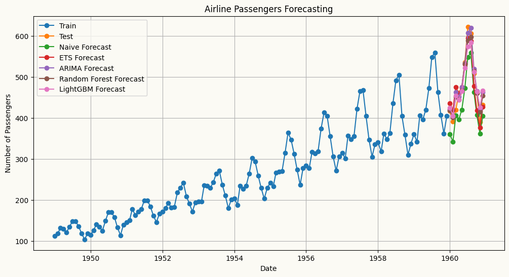
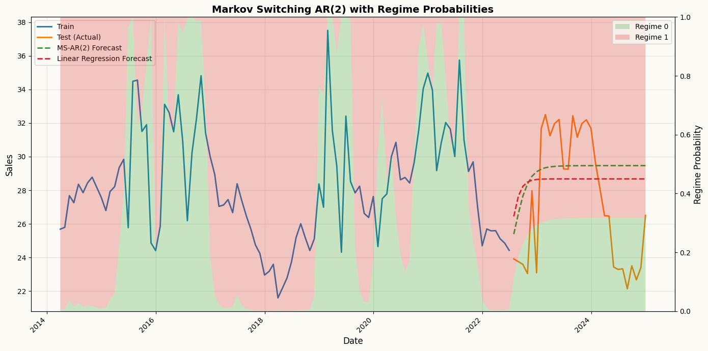
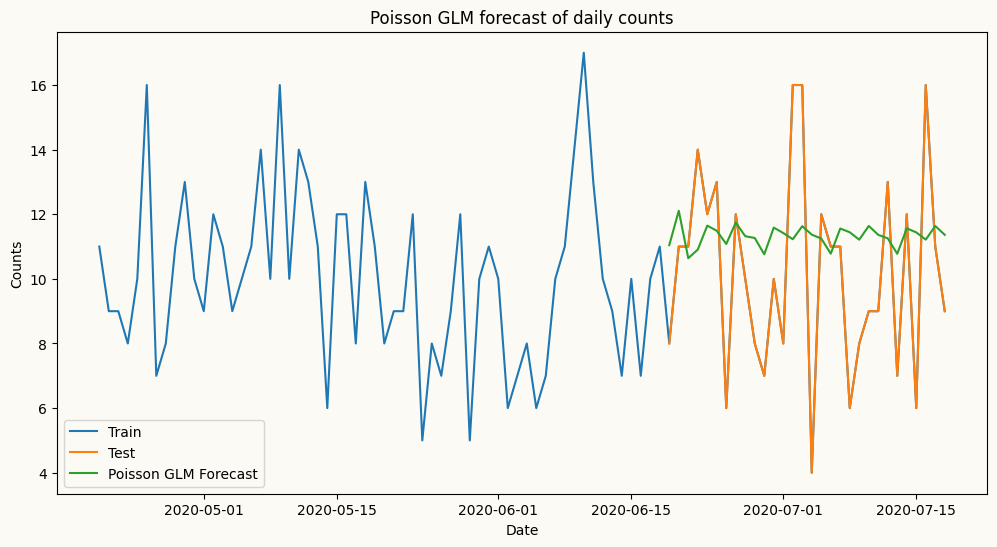
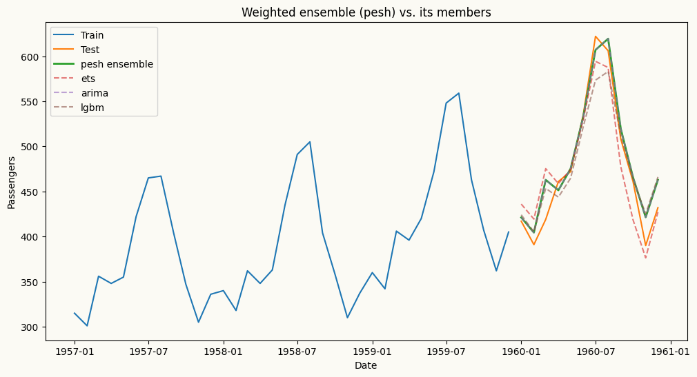
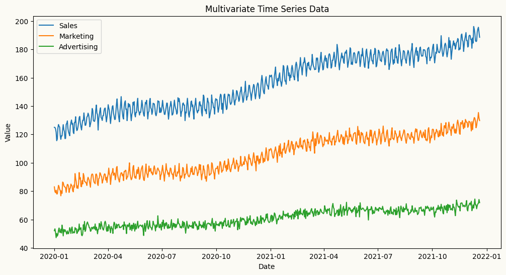
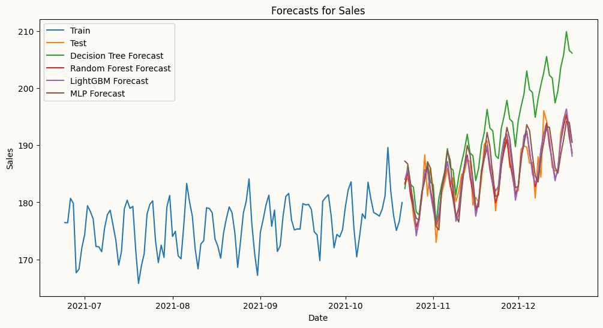
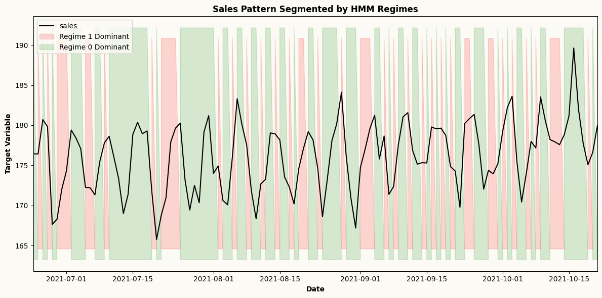
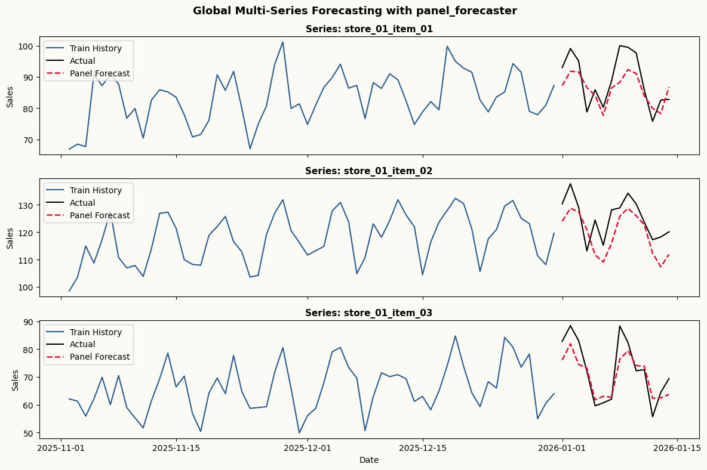

<!-- WARNING: THIS FILE WAS AUTOGENERATED! DO NOT EDIT! -->

## Models zoo

### Univariate forecasters

All models share a consistent interface — each accepts a target_col to
specify the target series, along with any model-specific parameters.
Fitting is done via .fit(df) and forecasting via .forecast(H). Exogenous
variables, where supported, are passed at the forecasting step and
aligned automatically. All models also expose .cross_validate() for
evaluation, supporting both expanding and sliding window strategies with
a configurable step size.

The table below summarises the available univariate forecasters, from
simple baselines to statistical and machine learning models, along with
a minimal usage example for each.

<table>
<colgroup>
<col style="width: 27%" />
<col style="width: 30%" />
<col style="width: 41%" />
</colgroup>
<thead>
<tr>
<th><strong>Models</strong></th>
<th><strong>Description</strong></th>
<th><strong>Usage Example</strong></th>
</tr>
</thead>
<tbody>
<tr>
<td>Naive Forecaster</td>
<td>A simple forecasting model that uses the last observed value or last
seasonal value as the forecast.</td>
<td><code> from peshbeen.models import naive <br> model =
naive(target_col=‘target column name’, season_period=None) <br>
model.fit(df) <br> forecasts = model.forecast(H=10)</td>
</tr>
<tr>
<td>ETS (Exponential Smoothing state space models)</td>
<td>ETS forecaster that wraps the <code>statsmodels</code>
implementation, allowing for easy integration and forecasting.</td>
<td><code> from peshbeen.models import ets <br> model =
ets(target_col=‘target column name’, trend=‘add’, seasonal=‘add’,
seasonal_periods=12, smoothing_level=0.1, smoothing_trend=0.1,
smoothing_seasonal=0.1) <br> model.fit(df) <br> forecasts =
model.forecast(H=10)</td>
</tr>
<tr>
<td>Auto ARIMA (Automatic Model Selection)</td>
<td>Automatic ARIMA model selection implementing the Hyndman-Khandakar
(2008) stepwise algorithm and grid search, with repeated KPSS
stationarity tests.</td>
<td><code> from peshbeen.models import auto_arima <br> model =
auto_arima(target_col=‘target column name’, seasonal_length=12,
stepwise=True) <br> model.fit(df) <br> forecasts =
model.forecast(H=10)</td>
</tr>
<tr>
<td>ARIMA (AutoRegressive Integrated Moving Average)</td>
<td>A fast, native forecaster built on vectorized NumPy and SciPy
digital filtering (lfilter) with conditional sum-of-squares (CSS) and
L-BFGS-B estimation.</td>
<td><code> from peshbeen.models import arima <br> model =
arima(target_col=‘target column name’, order=(1, 1, 1)) <br>
model.fit(df) <br> forecasts = model.forecast(H=10)</td>
</tr>
<tr>
<td>Machine Learning Regressors — any scikit-learn-compatible regressor,
from LinearRegression, RandomForest and AdaBoost to XGBoost, LightGBM,
CatBoost and TabPFN.</td>
<td>A unified forecasting wrapper for any compatible regression
model.</td>
<td><code> from peshbeen.models import ml_forecaster <br> from
sklearn.ensemble import RandomForestRegressor <br> model =
ml_forecaster(target_col=‘target column name’,
model=RandomForestRegressor(n_estimators=100)) <br> model.fit(df) <br>
forecasts = model.forecast(H=10)</td>
</tr>
<tr>
<td>Direct Machine Learning Forecaster (<a
href="https://mustafaslanCoto.github.io/peshbeen/modules/02_models/direct_ml.html#ml_direct_forecaster"><code>ml_direct_forecaster</code></a>)</td>
<td>Direct multi-step machine learning forecaster that trains an
independent regressor for each step in horizon <span
class="math inline"><em>H</em></span>, avoiding recursive error
accumulation.</td>
<td><code> from peshbeen.models import ml_direct_forecaster <br> from
lightgbm import LGBMRegressor <br> model =
ml_direct_forecaster(model=LGBMRegressor(), target_col=‘target column
name’, H=10, lags=[1, 2, 7]) <br> model.fit(df) <br> forecasts =
model.forecast(H=10)</td>
</tr>
<tr>
<td>MS-ARR (Markov-Switching AutoRegressive Regression)</td>
<td>Models time series with hidden regime changes (e.g. recession
vs. growth, low vs. high volatility) using autoregressive dynamics and
optional exogenous variables.</td>
<td><code> from peshbeen.models import ms_arr <br> model =
ms_arr(target_col=‘target column name’, n_components=2, lags = 2,
n_iter=100) <br> model.fit(df) <br> forecasts =
model.forecast(H=10)</td>
</tr>
<tr>
<td>GLM (Generalized Linear Models)</td>
<td>A statsmodels-backed generalization of linear regression that
supports non-Gaussian response distributions — including Poisson for
count data and Gamma for strictly positive, skewed data.</td>
<td><code> from peshbeen.models import glm <br> import statsmodels.api
as sm <br> model = glm(target_col=‘target column name’,
family=sm.families.Poisson(), lags=2) <br> model.fit(df) <br> forecasts
= model.forecast(H=10)</td>
</tr>
</tbody>
</table>

**Usage example**

Regardless of whether you use ETS, ARIMA, a machine learning regressor,
or any other supported model, the interface is consistent. The
.forecast(H) method returns a consistent numpy array of forecasts, and
the .cross_validate() method provides a standardized way to evaluate
model performance across different time series and forecasting horizons.

- **Index of data:** A `DatetimeIndex` (or `RangeIndex`) is required for
  all models to ensure proper time series handling and forecasting. The
  index is recommended to be at a regular frequency without any missing
  timestamps.

- **Target column:** The `target_col` parameter specifies the name of
  the column in the input DataFrame that contains the time series to be
  forecasted.

Example usage for different models are provided in cells below,
demonstrating how to fit and forecast with each model type using the
same dataset and target column for consistency.

``` python
from peshbeen.models import naive, ets, arima, ml_forecaster
from peshbeen.datasets import load_airline_passengers
from sklearn.ensemble import RandomForestRegressor
from lightgbm import LGBMRegressor

airline_passengers = load_airline_passengers()
train_data = airline_passengers[:-12]
test_data = airline_passengers[-12:]

## naive
naive_model = naive(target_col="passengers", season_period=12)
naive_model.fit(train_data)
naive_forecast = naive_model.forecast(H=12)

## ets
ets_model = ets(target_col="passengers", seasonal="additive", trend="additive", seasonal_periods=12,
                smoothing_level=0.5, smoothing_trend=0.5,smoothing_seasonal=0.5)
ets_model.fit(train_data)
ets_forecast = ets_model.forecast(H=12)

## arima
arima_model = arima(target_col="passengers", order=(1, 1, 1), seasonal_order=(1, 1, 1), seasonal_length=12)
arima_model.fit(train_data)
arima_forecast = arima_model.forecast(H=12)
## random forest
rf_model = ml_forecaster(target_col="passengers", model=RandomForestRegressor(n_estimators=100, random_state=42),
                         difference=1, lags=12)
rf_model.fit(train_data)
rf_forecast = rf_model.forecast(H=12)
## lightgbm
lgbm_model = ml_forecaster(target_col="passengers", model=LGBMRegressor(n_estimators=100, random_state=42, verbose=-1),
                           difference=1, lags=12)
lgbm_model.fit(train_data)
lgbm_forecast = lgbm_model.forecast(H=12)

## plotting
import matplotlib.pyplot as plt
plt.figure(figsize=(12, 6))
plt.plot(train_data.index, train_data["passengers"], label="Train", marker="o")
plt.plot(test_data.index, test_data["passengers"], label="Test", marker="o")
plt.plot(test_data.index, naive_forecast, label="Naive Forecast", marker="o")
plt.plot(test_data.index, ets_forecast, label="ETS Forecast", marker="o")
plt.plot(test_data.index, arima_forecast, label="ARIMA Forecast", marker="o")
plt.plot(test_data.index, rf_forecast, label="Random Forest Forecast", marker="o")
plt.plot(test_data.index, lgbm_forecast, label="LightGBM Forecast", marker="o")
plt.title("Airline Passengers Forecasting")
plt.xlabel("Date")
plt.ylabel("Number of Passengers")
plt.legend()
plt.grid()
plt.show()
```



#### **Automatic Model Selection with `auto_arima`**

`auto_arima` automates ARIMA and SARIMA order selection using the
**Hyndman-Khandakar (2008)** stepwise search algorithm and repeated KPSS
stationarity tests. You can inspect the top candidate models with
`.top_models(n)` and extract parameter dictionaries for any candidate
rank using `.get_orders(rank=k)` or `.best_orders`.

``` python
from peshbeen.models import auto_arima

# Stepwise automatic model selection
auto_model = auto_arima(target_col='passengers', seasonal_length=12, max_p=3, max_q=3, max_P=2, max_Q=2, stepwise=True)
auto_model.fit(train_data)

# Summary and top candidates
print(auto_model.summary())
print('\nTop 3 candidate models:')
display(auto_model.top_models(3))

# Multi-step out-of-sample forecast
auto_forecast = auto_model.forecast(H=12)
print('\nSelected Best Parameters:', auto_model.best_orders)
```

    ======================================================================================
                      Auto ARIMA Model Selection Summary
    ======================================================================================
    Selection Algorithm:    Hyndman-Khandakar Stepwise Search
    Stationarity Test:      KPSS (alpha = 0.05) -> d = 1
    Selected Best Model:    ARIMA(1,1,0) (0,1,0)[12]
    Include Constant:       False
    Optimized Criterion:    AICC = 900.7323
    Information Criteria:   AIC = 900.6289 | AICc = 900.7323 | BIC = 906.1871
    Models Evaluated:       14 models
    --------------------------------------------------------------------------------------
    Best Model Parameter Estimates:
    ======================================================================================
    Unified Peshbeen ARIMA Model Results: SARIMAX(1,1,0)x(0,1,0,12)
    ======================================================================================
    No. Observations: 132          Log-Likelihood: -448.314     AIC: 900.629   
    Sigma^2:          109.5980     Fit Time (s):   0.0032       BIC: 906.187   
    ======================================================================================
      Parameter           Estimate     Std.Err      t-stat       P>|z|       [0.025   0.975]
    --------------------------------------------------------------------------------------
      ar.L1                -0.2448      0.0901      -2.718      0.0066 **   [ -0.421  -0.068]
      sigma2              109.5980
    --------------------------------------------------------------------------------------
    Signif. codes:  0 '***' 0.001 '**' 0.01 '*' 0.05 '.' 0.1 ' ' 1
    ======================================================================================

    Top 3 candidate models:

<div>
<style scoped>
    .dataframe tbody tr th:only-of-type {
        vertical-align: middle;
    }
&#10;    .dataframe tbody tr th {
        vertical-align: top;
    }
&#10;    .dataframe thead th {
        text-align: right;
    }
</style>

<table class="dataframe" data-quarto-postprocess="true" data-border="1">
<thead>
<tr style="text-align: right;">
<th data-quarto-table-cell-role="th"></th>
<th data-quarto-table-cell-role="th">model</th>
<th data-quarto-table-cell-role="th">constant</th>
<th data-quarto-table-cell-role="th">criterion</th>
<th data-quarto-table-cell-role="th">score</th>
<th data-quarto-table-cell-role="th">aic</th>
<th data-quarto-table-cell-role="th">aicc</th>
<th data-quarto-table-cell-role="th">bic</th>
</tr>
</thead>
<tbody>
<tr>
<td data-quarto-table-cell-role="th">0</td>
<td>ARIMA(1,1,0)(0,1,0)[12]</td>
<td>False</td>
<td>aicc</td>
<td>900.7323</td>
<td>900.6289</td>
<td>900.7323</td>
<td>906.1871</td>
</tr>
<tr>
<td data-quarto-table-cell-role="th">1</td>
<td>ARIMA(0,1,1)(0,1,0)[12]</td>
<td>False</td>
<td>aicc</td>
<td>901.5245</td>
<td>901.4211</td>
<td>901.5245</td>
<td>906.9793</td>
</tr>
<tr>
<td data-quarto-table-cell-role="th">2</td>
<td>ARIMA(1,1,1)(0,1,0)[12]</td>
<td>False</td>
<td>aicc</td>
<td>901.8862</td>
<td>901.6775</td>
<td>901.8862</td>
<td>910.0149</td>
</tr>
</tbody>
</table>

</div>

    Selected Best Parameters: {'order': (1, 1, 0), 'seasonal_order': (0, 1, 0), 'seasonal_length': 12, 'include_constant': False}

#### **Direct Multi-Step Forecasting with [`ml_direct_forecaster`](https://mustafaslanCoto.github.io/peshbeen/modules/02_models/direct_ml.html#ml_direct_forecaster)**

Standard machine learning forecasters
([`ml_forecaster`](https://mustafaslanCoto.github.io/peshbeen/modules/02_models/ml_forecast.html#ml_forecaster))
use a **recursive** strategy: they predict horizon *h* = 1, append that
prediction as a new lag, and step forward iteratively to predict
*h* = 2, 3, …, *H*. While flexible, recursive forecasting can accumulate
prediction errors over long horizons.

[`ml_direct_forecaster`](https://mustafaslanCoto.github.io/peshbeen/modules/02_models/direct_ml.html#ml_direct_forecaster)
uses a **direct multi-step** strategy: it trains a dedicated regressor
for each individual horizon step *h* ∈ {1, …, *H*}. Each model is
optimized specifically for its forecast lead time directly from observed
historical features, preventing error compounding.

``` python
from peshbeen.models import ml_direct_forecaster
from peshbeen.datasets import load_airline_passengers
from lightgbm import LGBMRegressor

pax = load_airline_passengers()
pax_train = pax[:-12]
pax_test = pax[-12:]

# Direct forecaster: trains independent models, one per horizon step up to H=12
direct_model = ml_direct_forecaster(
    model=LGBMRegressor(n_estimators=50, random_state=42, verbose=-1),
    target_col='passengers',
    H=12,
    lags=12
)
direct_model.fit(pax_train)
direct_fc = direct_model.forecast(H=12)

print("Direct ML forecasts (H=12):", direct_fc[:5])
```

    Direct ML forecasts (H=12): [385.82705361 392.99494058 419.0278088  420.87151715 432.4001238 ]

#### **Forecasting with TabPFN**

TabPFN is a powerful transformer-based model designed for tabular data.
[`ml_forecaster`](https://mustafaslanCoto.github.io/peshbeen/modules/02_models/ml_forecast.html#ml_forecaster)
provides a wrapper to use TabPFN for time series forecasting by treating
the problem as a regression task. Below is an example of how to use
TabPFN for forecasting with the
[`ml_forecaster`](https://mustafaslanCoto.github.io/peshbeen/modules/02_models/ml_forecast.html#ml_forecaster)
wrapper.

``` python
import tabpfn_client
from tabpfn_client import TabPFNRegressor, set_access_token
TABPFN_TOKEN = "ENTER_YOUR_TOKEN_HERE"
tabpfn_client.set_access_token(TABPFN_TOKEN)

tabpfn_model = ml_forecaster(target_col="passengers", model=TabPFNRegressor(), lags=12, difference=1)
tabpfn_model.fit(train_data)
tabpfn_forecast = tabpfn_model.forecast(H=12)
```

#### **Forecasting with MS-ARR: Capturing Regime Changes**

Models like ARIMA or Random Forest assume the “rules” of a time series
are constant. However, real-world data often undergoes structural
shifts—moving between a high-volatility “crisis” mode and a stable
“growth” mode.

While the models above assume a stable relationship over time,
real-world data sometimes exhibits regime changes. Peshbeen includes
native support for MS-ARR to model these “regime changes” (e.g.,
shifting from a high-volatility to a low-volatility state) explicitly.
MS-ARR models capture these dynamics by allowing the time series to
switch between different hidden regimes, each with its own
autoregressive structure.

**How it Works: The Hidden Dynamics**

The AR-MSR model in peshbeen is defined by four core
components:Regime-Dependent Dynamics: In each regime *r*, the process
follows a unique autoregressive structure:

$$
y_t \mid (r_t = r) = \beta\_{0}^{(r)} + \sum\_{i=1}^{p} \beta\_{i}^{(r)} y\_{t-i} + \sum\_{m=1}^{M} \beta\_{m}^{(r)} X\_{tm} + \epsilon_t, \quad \epsilon_t \sim \mathcal{N}(0, \sigma_r^2)
$$

*y*<sub>*t*</sub> is the target variable at time *t*,
*X*<sub>*t**m*</sub> are optional exogenous variables, and
*ϵ*<sub>*t*</sub> is the error term. The intercept (*β*<sub>0</sub>),
coefficients (*β*<sub>*i*</sub>), and volatility
(*σ*<sub>*r*</sub><sup>2</sup>) all adapt to the specific regime.

**Transition Probability Matrix (**P**):** The model learns the
probability of moving from one regime to another. For a 2-regime model,
the matrix **P** looks like this:

$$
\mathbf{P} = \begin{pmatrix} p\_{11} & p\_{12} \\ p\_{21} & p\_{22} \end{pmatrix}
$$

where *p*<sub>*i**j*</sub> is the probability of transitioning from
regime *i* to regime *j*. This captures the “stickiness” of states
(e.g., how likely a recession is to continue into the next period).

**Estimation via EM (Expectation-Maximization) Algorithm:** The model
parameters are estimated using the EM algorithm, which iteratively
refines estimates of the hidden states and the model parameters until
convergence. Under the hood, peshbeen calculates the transition matrix
and the filtered probabilities (the likelihood of being in a state at
any given time) using the Baum-Welch algorithm. This uses a
Forward-Backward pass to efficiently find the Maximum Likelihood
Estimates (MLE) for the hidden Markov process.

**The Markov Property:** Transitions depend only on the current state,
not the entire history. This allows the model to remain computationally
efficient even as the complexity of the data increases.

**Why use MS-ARR in Peshbeen?**

- **Capture Non-Linearity:** It models complex shifts that ARIMA or
  standard ML models might miss.

- **Regime Inference:** Use `model.predict_states()` to see a historical
  timeline of when your series was likely in each regime. Use
  `model.predict_proba()` to get the probability of being in each regime
  at any point in time.

- **Adaptive Forecasting:** The forecast accounts for the probability of
  a regime shift occurring during the forecast horizon *H*.

``` python
## Create a sales series with regime switches
import numpy as np
import pandas as pd

np.random.seed(42)
n = 300
dates = pd.date_range(start="2000-01-01", periods=n, freq="ME")

# Define hidden regimes (Regime 0 is "Stable", Regime 1 is "High")
regime_switches = np.zeros(n)
for i in range(1, n):
    # Create persistent regimes (90% chance to stay in current state)
    if regime_switches[i-1] == 0:
        regime_switches[i] = np.random.choice([0, 1], p=[0.9, 0.1])
    else:
        regime_switches[i] = np.random.choice([0, 1], p=[0.2, 0.8])

series = np.zeros(n)
# Generate data with AR(1) logic based on the current regime
for t in range(1, n):
    if regime_switches[t] == 0:
        # Regime 0: Low mean, high lag dependency
        series[t] = 5 + 0.8 * series[t-1] + np.random.normal(0, 1)
    else:
        # Regime 1: High mean, low lag dependency
        series[t] = 25 + 0.2 * series[t-1] + np.random.normal(0, 3)

ms_data = pd.DataFrame({"sales": series}, index=dates)

train_ms =  ms_data.iloc[:-30]
test_ms = ms_data.iloc[-30:]

from peshbeen.models import ms_arr
ms_arr_model = ms_arr(target_col="sales", n_components=2, lags=2, add_constant=True, n_iter=50, tol=1e-4, random_state=42)
ms_arr_model.fit(train_ms)
ms_arr_forecast = ms_arr_model.forecast(H=30)

regime_probs = ms_arr_model.predict_proba()

## also  create linear regression forecasts for comparison
from sklearn.linear_model import LinearRegression
lr_model = ml_forecaster(target_col="sales", model=LinearRegression(), lags=2)
lr_model.fit(train_ms)
lr_forecast = lr_model.forecast(H=30)

import matplotlib.pyplot as plt

fig, ax1 = plt.subplots(figsize=(14, 7))

# Get regime probabilities
regime_probs_train = ms_arr_model.predict_proba()
# `forecast_forward` is populated by the .forecast(H) call above: an (n_regimes, H) array of
# regime probabilities over the forecast horizon. Row 0 -> Regime 0, row 1 -> Regime 1.
regime_probs_forecast = ms_arr_model.forecast_forward

# No lag offset needed - already aligned with full training data!
n_train_tail = 100

# Get tail of training data and regime probs
train_dates_tail = train_ms.index[-n_train_tail:]
train_sales_tail = train_ms["sales"].values[-n_train_tail:]
regime_probs_tail = [regime_probs_train[0][-n_train_tail:], 
                     regime_probs_train[1][-n_train_tail:]]

# Combine with forecast
dates_full = list(train_dates_tail) + list(test_ms.index)
regime_probs_full = [np.concatenate([regime_probs_tail[0], regime_probs_forecast[0]]),
                     np.concatenate([regime_probs_tail[1], regime_probs_forecast[1]])]

# Plot the time series on primary axis
ax1.plot(train_dates_tail, train_sales_tail, 
         label="Train", color="C0", linewidth=2)
ax1.plot(test_ms.index, test_ms["sales"], 
         label="Test (Actual)", color="C1", linewidth=2)
ax1.plot(test_ms.index, ms_arr_forecast, 
         label="MS-AR(2) Forecast", color="C2", linestyle='--', linewidth=2)
ax1.plot(test_ms.index, lr_forecast, 
         label="Linear Regression Forecast", color="C3", linestyle='--', linewidth=2)

ax1.set_ylabel("Sales", fontsize=12)
ax1.set_xlabel("Date", fontsize=12)
ax1.legend(loc="upper left", fontsize=10)
ax1.grid(True, alpha=0.3)

# Overlay regime probabilities as stacked area
ax2 = ax1.twinx()
ax2.stackplot(dates_full,
              regime_probs_full[0], 
              regime_probs_full[1],
              labels=['Regime 0', 'Regime 1'], 
              alpha=0.25, 
              colors=['C2', 'C3'])

ax2.set_ylabel("Regime Probability", fontsize=12)
ax2.set_ylim(0, 1)
ax2.legend(loc="upper right", fontsize=10)

plt.title("Markov Switching AR(2) with Regime Probabilities", fontsize=14, fontweight='bold')
plt.setp(ax1.get_xticklabels(), rotation=45, ha="right")
plt.tight_layout()
plt.show()
```



#### **Forecasting count data with a GLM (Poisson)**

For non-negative count series — hospital admissions, call volumes,
demand — a Poisson (or Gamma) GLM is often a better fit than a Gaussian
model. peshbeen’s
[`glm`](https://mustafaslanCoto.github.io/peshbeen/modules/02_models/glm.html#glm)
wraps `statsmodels` and takes a `family` **object** (not a string),
e.g. `sm.families.Poisson()` for counts or `sm.families.Gamma()` for
strictly positive, skewed data. It supports the same `lags` /
`difference` / `trend` / `box_cox` interface as the other models, and
exposes information criteria (`.aic`, `.bic`, `.hqc`) for model
comparison.

``` python
from peshbeen.models import glm
import statsmodels.api as sm
import matplotlib.pyplot as plt
import pandas as pd

## generate a counted series with calendar effects and lags, to demonstrate Poisson GLM
df_count = pd.DataFrame({"count": np.random.poisson(lam=10, size=200)}, 
                        index=pd.date_range(start="2020-01-01", periods=200, freq="D"))
df_count["day_of_week"] = df_count.index.dayofweek
df_count["month"] = df_count.index.month
glm_cat = ["day_of_week", "month"]
# daily emergency-admission counts in Wales
glm_cat = ["day_of_week", "month"]

glm_train = df_count.iloc[:-30]
glm_test = df_count.iloc[-30:]

from sklearn.preprocessing import OneHotEncoder
ohe = OneHotEncoder(drop='first', sparse_output=False, handle_unknown="ignore")

# Poisson GLM for count data, with weekly lags and calendar features
poisson_model = glm(family=sm.families.Poisson(), target_col="count",
                    lags=6, cat_variables=glm_cat, categorical_encoder=ohe)
poisson_model.fit(df_count)
poisson_forecast = poisson_model.forecast(H=30, exog=df_count[glm_cat])


plt.figure(figsize=(12, 6))
plt.plot(df_count.index[-90:], df_count["count"][-90:], label="Train")
plt.plot(df_count.index[-30:], df_count["count"][-30:], label="Test")
plt.plot(df_count.index[-30:], poisson_forecast, label="Poisson GLM Forecast")
plt.title("Poisson GLM forecast of daily counts")
plt.xlabel("Date")
plt.ylabel("Counts")
plt.legend()
plt.show()
```



#### **Combining models with the [`pesh`](https://mustafaslanCoto.github.io/peshbeen/modules/02_models/herne_pesh.html#pesh) ensemble**

[`pesh`](https://mustafaslanCoto.github.io/peshbeen/modules/02_models/herne_pesh.html#pesh)
combines several fitted models behind the same `.fit` / `.forecast`
interface. The combination weights can be **equal**
(`weighting_scheme=None`), **user-specified** (a dict that sums to 1),
or **optimised to minimise a chosen metric**. To optimise the weights,
call `cross_validate(..., weighting_scheme="optimize")` — the optimal
weights are then stored in `self.optimal_weights_` and can be passed
back into a new
[`pesh`](https://mustafaslanCoto.github.io/peshbeen/modules/02_models/herne_pesh.html#pesh)
instance. `forecast(H)` returns a DataFrame with one column per member
model plus a combined `"pesh"` column.

``` python
from peshbeen.models import ets, arima, ml_forecaster, pesh
from peshbeen.datasets import load_airline_passengers
from peshbeen.metrics import RMSE
from lightgbm import LGBMRegressor

pax = load_airline_passengers()
pesh_train = pax[:-12]
pesh_test = pax[-12:]

# build the member models (note: ml_forecaster uses model=, not estimator=)
members = {
    "ets":   ets(target_col="passengers", seasonal="additive", trend="additive",
                 seasonal_periods=12, smoothing_level=0.5, smoothing_trend=0.5, smoothing_seasonal=0.5),
    "arima": arima(target_col="passengers", order=(1, 1, 1), seasonal_order=(1, 1, 1), seasonal_length=12),
    "lgbm":  ml_forecaster(target_col="passengers",
                           model=LGBMRegressor(n_estimators=100, random_state=42, verbose=-1),
                           difference=1, lags=12),
}

# 1) optimise the ensemble weights via cross-validation, then read them back
weight_finder = pesh(models={k: m.copy() for k, m in members.items()})
cv_results = weight_finder.cross_validate(df=pesh_train, cv_split=3, test_size=12,
                                          metrics=[RMSE], weighting_scheme="optimize")
opt_weights = weight_finder.optimal_weights_
# optimal_weights_ also contains a "pesh" key for the combined column; keep only member weights
opt_weights = {k: v for k, v in opt_weights.items() if k in members}
print("Optimised weights:", opt_weights)

# 2) fit a fresh ensemble with the optimised weights and forecast
ensemble = pesh(models=members, weighting_scheme=opt_weights)
ensemble.fit(pesh_train)
ensemble_forecast = ensemble.forecast(H=12)   # DataFrame: one column per model + 'pesh'

import matplotlib.pyplot as plt
plt.figure(figsize=(12, 6))
plt.plot(pesh_train.index[-36:], pesh_train["passengers"][-36:], label="Train")
plt.plot(pesh_test.index, pesh_test["passengers"], label="Test")
plt.plot(pesh_test.index, ensemble_forecast["pesh"], label="pesh ensemble", linewidth=2)
for name in members:
    plt.plot(pesh_test.index, ensemble_forecast[name], linestyle="--", alpha=0.6, label=name)
plt.title("Weighted ensemble (pesh) vs. its members")
plt.xlabel("Date")
plt.ylabel("Passengers")
plt.legend()
plt.show()
```

    Optimised weights: {'ets': np.float64(0.0), 'arima': np.float64(1.0), 'lgbm': np.float64(6.228351168147128e-14)}



### Multivariate forecasters

> **Differentiating Forecasters Across Multiple Series:**
>
> - **Wide Multivariate Forecasters
>   ([`ml_multi_output_forecaster`](https://mustafaslanCoto.github.io/peshbeen/modules/02_models/multi_output.html#ml_multi_output_forecaster),
>   [`var`](https://mustafaslanCoto.github.io/peshbeen/modules/02_models/var.html#var),
>   [`ms_var`](https://mustafaslanCoto.github.io/peshbeen/modules/02_models/ms_var.html#ms_var)):**
>   - **Data format:** Expect **wide format** data — a DataFrame where
>     each column is an endogenous target series
>     (`target_cols = ['series_1', 'series_2', ...]`) sharing identical
>     timestamps on a common DatetimeIndex.
>   - **Mechanism:** Model simultaneous feedback, cross-variable lag
>     interactions, and joint system dynamics where past values of
>     series A directly inform series B and vice versa.
>   - **Trade-offs:** Highly effective for capturing rich feedback loops
>     between a small-to-moderate set of interdependent series (e.g.,
>     price and demand, interest rate and inflation). However, because
>     feature dimensionality scales with *K* × *L* (number of series ×
>     lags), wide models are not intended for scaling to hundreds or
>     thousands of series.
> - **Multi-Series Forecasters
>   ([`panel_forecaster`](https://mustafaslanCoto.github.io/peshbeen/modules/02_models/panel_forecast.html#panel_forecaster),
>   [`ml_multi_forecaster`](https://mustafaslanCoto.github.io/peshbeen/modules/02_models/ml_multi_forecast.html#ml_multi_forecaster)):**
>   - **Data format:** Expect **long (panel) format** data — a DataFrame
>     with an entity ID column (`id_col`), a target column
>     (`target_col`), and timestamps.
>   - **Mechanism & Scaling:** Discussed in detail in the Multi-series
>     section below.

<table>
<colgroup>
<col style="width: 27%" />
<col style="width: 30%" />
<col style="width: 41%" />
</colgroup>
<thead>
<tr>
<th><strong>Models</strong></th>
<th><strong>Description</strong></th>
<th><strong>Usage Example</strong></th>
</tr>
</thead>
<tbody>
<tr>
<td><a
href="https://mustafaslanCoto.github.io/peshbeen/modules/02_models/multi_output.html#ml_multi_output_forecaster"><code>ml_multi_output_forecaster</code></a></td>
<td>Wide machine learning forecaster supporting multi-output regressors
(e.g. <code>RandomForestRegressor</code>,
<code>MultiOutputRegressor(LGBMRegressor())</code>) across multiple
target series with automatic lag and transformation engineering.</td>
<td><code> from peshbeen.models import ml_multi_output_forecaster <br>
model = ml_multi_output_forecaster(RandomForestRegressor(),
target_cols=[‘interest’, ‘inflation’], lags=4) <br> model.fit(df) <br>
fc = model.forecast(H=12) </code></td>
</tr>
<tr>
<td><a
href="https://mustafaslanCoto.github.io/peshbeen/modules/02_models/var.html#var"><code>var</code></a>
(Vector AutoRegression)</td>
<td>Vector autoregression modeling linear interdependencies across wide
target series, with per-series lag structure control.</td>
<td><code> from peshbeen.models import var <br> model =
var(target_cols=[‘col1’, ‘col2’], lags={‘col1’: 2, ‘col2’: [1, 2, 7]})
<br> model.fit(df) <br> forecasts = model.forecast(H=10) </code></td>
</tr>
<tr>
<td><a
href="https://mustafaslanCoto.github.io/peshbeen/modules/02_models/ms_var.html#ms_var"><code>ms_var</code></a>
(Markov-Switching VAR)</td>
<td>Multivariate extension of MS-ARR modeling joint series dynamics
across discrete hidden regimes.</td>
<td><code> from peshbeen.models import ms_var <br> model =
ms_var(target_cols=[‘col1’, ‘col2’], n_components=2, lags={‘col1’: 2,
‘col2’: [1, 2, 7]}) <br> model.fit(df) <br> forecasts =
model.forecast(H=10) </code></td>
</tr>
</tbody>
</table>

#### **Forecasting Wide Interdependent Series with [`ml_multi_output_forecaster`](https://mustafaslanCoto.github.io/peshbeen/modules/02_models/multi_output.html#ml_multi_output_forecaster)**

When forecasting multiple interconnected economic or operational series
stored in wide format (such as interest rates and inflation),
[`ml_multi_output_forecaster`](https://mustafaslanCoto.github.io/peshbeen/modules/02_models/multi_output.html#ml_multi_output_forecaster)
uses multi-target regressors (such as `RandomForestRegressor`,
`LinearRegression`, or `MultiOutputRegressor(LGBMRegressor())`) to
predict all series jointly from shared cross-series lags:

``` python
from peshbeen.datasets import load_interest_inflation
from peshbeen.models import ml_multi_output_forecaster
from sklearn.ensemble import RandomForestRegressor

macro_data = load_interest_inflation()
train_macro = macro_data.iloc[:-12]
test_macro = macro_data.iloc[-12:]

# Wide multi-output model: joint forecasting of interest rate and inflation
mo_model = ml_multi_output_forecaster(
    model=RandomForestRegressor(n_estimators=50, random_state=42),
    target_cols=['interest', 'inflation'],
    lags=4
)
mo_model.fit(train_macro)
macro_forecasts = mo_model.forecast(H=12)

print("Forecasted interest rates:", macro_forecasts['interest'][:4])
print("Forecasted inflation:", macro_forecasts['inflation'][:4])
```

    Forecasted interest rates: [0.06214 0.06626 0.06654 0.06192]
    Forecasted inflation: [0.         0.00449505 0.00784334 0.02892471]

**Example for multivariate forecasting works using the `VAR` model.**

Peshbeen’s `VAR` model allows you to specify different lag structures
for each target series, enabling you to capture the unique temporal
dependencies of each series while modeling their interdependencies.
Different than the implementation of the standard VAR in `statsmodels`,
which applies the same lag structure to all series, Peshbeen’s `VAR` can
have, for example, one series with 2 lags and another with 1, 2, and 7
lags. This flexibility allows user to tailor the model to the specific
characteristics of each series, improving forecasting performance.

``` python
import numpy as np
import pandas as pd
import matplotlib.pyplot as plt
## Create a multivariate autoregressive sales data with 3 features: sales, marketing spend, and advertising spend to show if we can capture the relationships between past values of all three features to forecast the future values of sales. 
date_range = pd.date_range(start='2020-01-01', periods=720, freq='D')
np.random.seed(42)
doy = date_range.dayofyear.to_numpy()  # force NumPy, not pandas Index
data1 = 120 + 0.1 * np.arange(720) + 5 * np.sin(2 * np.pi * doy / 7) + 6 * np.sin(2 * np.pi * doy / 365) + np.random.normal(0, 2, 720)
data2 = 80 + 0.07 * np.arange(720) + 3 * np.sin(2 * np.pi * doy / 7) + 4 * np.sin(2 * np.pi * doy / 365) + np.random.normal(0, 2, 720)
data3 = 50 + 0.03 * np.arange(720) + 1 * np.sin(2 * np.pi * doy / 7) + 2 * np.sin(2 * np.pi * doy / 365) + np.random.normal(0, 2, 720)

# create a multivariate dataset

multivariate_data = pd.DataFrame({'sales': data1, 'marketing': data2, 'advertising': data3}, index=date_range)

## add the day of week and month as categorical variables to the multivariate dataset
multivariate_data["day_of_week"] = multivariate_data.index.dayofweek
multivariate_data["month"] = multivariate_data.index.month

# plot the multivariate data
plt.figure(figsize=(12, 6))
plt.plot(multivariate_data.index, multivariate_data['sales'], label='Sales')
plt.plot(multivariate_data.index, multivariate_data['marketing'], label='Marketing')
plt.plot(multivariate_data.index, multivariate_data['advertising'], label='Advertising')
plt.title('Multivariate Time Series Data')
plt.xlabel('Date')
plt.ylabel('Value')
plt.legend()
plt.show()
```



``` python
from peshbeen.models import var
#split the data into train and test sets 
mv_train_data = multivariate_data.iloc[:-60]
mv_test_data = multivariate_data.iloc[-60:]

from sklearn.preprocessing import OneHotEncoder
ohe = OneHotEncoder(drop='first', sparse_output=False, handle_unknown="ignore")


cat_variables = ["day_of_week", "month"]

# we can specify different lag structures for each target series, enabling us to capture the unique temporal dependencies of each series while modeling their interdependencies.
# This flexibility allows user to tailor the model to the relationships between the series, improving forecasting performance.
var_model =var(target_cols=['sales', 'marketing', 'advertising'], lags={'sales': 7, 'marketing': [1, 7], 'advertising': 5},
               cat_variables=['day_of_week', 'month'], categorical_encoder=ohe)
var_model.fit(mv_train_data)
var_forecasts = var_model.forecast(H=60, exog=mv_test_data[['day_of_week', 'month']])
```

``` python
# plot the forecasts and the actual values for sales
plt.figure(figsize=(12, 6))
plt.plot(mv_train_data.index[-120:], mv_train_data['sales'][-120:], label='Train')
plt.plot(mv_test_data.index, mv_test_data['sales'], label='Test')
plt.plot(mv_test_data.index, var_forecasts['sales'], label='VAR Forecast')
plt.title('VAR Forecast for Sales')
plt.xlabel('Date')
plt.ylabel('Sales')
plt.legend()
plt.show()
```



**Example for regime-switching multivariate forecasting using the
`MS-VAR` model.**

[`ms_var`](https://mustafaslanCoto.github.io/peshbeen/modules/02_models/ms_var.html#ms_var)
is the multivariate extension of
[`ms_arr`](https://mustafaslanCoto.github.io/peshbeen/modules/02_models/ms_arr.html#ms_arr):
it models several series jointly with vector-autoregressive dynamics
*while* allowing the whole system to switch between a small number of
hidden regimes (e.g. a calm regime and a volatile one). Like
[`var`](https://mustafaslanCoto.github.io/peshbeen/modules/02_models/var.html#var),
it accepts a **per-series lag dictionary**, so each target can have its
own lag structure. After fitting you can inspect the inferred regimes
with `predict_states()` (most-likely regime per timestep) and
`predict_proba()` (full posterior over regimes), and read off
information criteria via `.aic`, `.bic`, and `.hqc`.

We reuse the `mv_train_data` / `mv_test_data` split from the `VAR`
example above.

``` python
from peshbeen.models import ms_var

# Two hidden regimes; per-series lag structure as with var.
msvar_model = ms_var(
    n_components=2,
    target_cols=['sales', 'marketing', 'advertising'],
    lags={'sales': 7, 'marketing': [1, 7], 'advertising': 5},
    cat_variables=['day_of_week', 'month'],
    categorical_encoder=ohe,
    n_iter=100,
    random_state=123,
)
msvar_model.fit(mv_train_data)

# forecast() returns a dict keyed by target column name (each value a length-H array)
msvar_forecasts = msvar_model.forecast(H=60, exog=mv_test_data[['day_of_week', 'month']])

print("Forecast keys:", list(msvar_forecasts.keys()))
print("AIC: {:.1f} | BIC: {:.1f}".format(msvar_model.aic, msvar_model.bic))
```

    Forecast keys: ['sales', 'marketing', 'advertising']
    AIC: 8562.5 | BIC: 9490.2

``` python
# Inspect the inferred regimes over the training period.
states = msvar_model.predict_states()   # most-likely regime at each in-sample timestep
proba = msvar_model.predict_proba()      # full posterior, shape (n_components, T)

fig, ax = plt.subplots(figsize=(12, 6))

# 1. Plot the FULL target variable
ax.plot(mv_train_data.index[-120:], mv_train_data[-120:]["sales"], label='sales', color='black', linewidth=1.5)

is_regime_1 = proba[0][-120:] >= 0.5
is_regime_0 = ~is_regime_1
    
# 3. Apply background shading using fill_between
ax.fill_between(
    mv_train_data.index[-120:], 
    ax.get_ylim()[0], 
    ax.get_ylim()[1], 
    where=is_regime_1, 
    color='red', 
    alpha=0.15, 
    label='Regime 1 Dominant',
    interpolate=True
)

ax.fill_between(
    mv_train_data.index[-120:], 
    ax.get_ylim()[0], 
    ax.get_ylim()[1], 
    where=is_regime_0, 
    color='green', 
    alpha=0.15, 
    label='Regime 0 Dominant',
    interpolate=True
)

# 4. Formatting
ax.set_xlabel('Date', fontweight='bold')
ax.set_ylabel('Target Variable', fontweight='bold')
ax.set_title('Sales Pattern Segmented by HMM Regimes', fontweight='bold')
ax.legend(loc='upper left', frameon=True)
ax.margins(x=0) 

plt.tight_layout()
plt.show()
```



### Multi-series forecasters

**Multi-series forecasters** train global machine learning models across
collections of many individual time series (e.g. sales across 100
stores, demand for 1,000 SKUs, or patient admissions across multiple
hospital wards) sharing a common schema indexed by an entity ID
(`id_col`).

> **Comparing
> [`panel_forecaster`](https://mustafaslanCoto.github.io/peshbeen/modules/02_models/panel_forecast.html#panel_forecaster)
> vs. [`ml_multi_forecaster`](https://mustafaslanCoto.github.io/peshbeen/modules/02_models/ml_multi_forecast.html#ml_multi_forecaster):**
>
> - **[`panel_forecaster`](https://mustafaslanCoto.github.io/peshbeen/modules/02_models/panel_forecast.html#panel_forecaster)
>   (Global Pooled Panel):**
>   - *How it works:* Generates standard lag features
>     (`lag_1, lag_2, \dots`) for each series independently, then
>     vertically pools all samples into a single training table.
>   - *Potential advantages:* Highly scalable to thousands of series;
>     pools statistical power across related series (which helps prevent
>     overfitting on short series); efficient memory footprint; handles
>     cold-start series at inference time without architectural changes.
>   - *Considerations:* Does not directly incorporate the historical
>     lags of series A as input features to predict series B.
> - **[`ml_multi_forecaster`](https://mustafaslanCoto.github.io/peshbeen/modules/02_models/ml_multi_forecast.html#ml_multi_forecaster)
>   (Multi-Series with Cross-Series Interdependencies):**
>   - *How it works:* Extends multi-series pooling by capturing
>     cross-series lag interdependencies across series, allowing one
>     series’ temporal history to directly inform another’s forecast.
>   - *Potential advantages:* Captures cross-series influences and
>     substitution or complementary effects in multi-series collections.
>   - *Considerations:* Requires aligning series across time, increasing
>     feature dimensionality and training cost compared to independent
>     panel pooling.

#### **Global Panel Forecasting with [`panel_forecaster`](https://mustafaslanCoto.github.io/peshbeen/modules/02_models/panel_forecast.html#panel_forecaster)**

In many practical settings — such as retail inventory, logistics, or
healthcare operations — you need to forecast hundreds or thousands of
distinct series simultaneously. Rather than fitting thousands of
individual univariate models,
[`panel_forecaster`](https://mustafaslanCoto.github.io/peshbeen/modules/02_models/panel_forecast.html#panel_forecaster)
trains a unified global regressor across all series.

Here we use
[`load_sales()`](https://mustafaslanCoto.github.io/peshbeen/modules/datasets.html#load_sales)
to forecast multiple store-item series simultaneously:

``` python
from peshbeen.datasets import load_sales
from peshbeen.models import panel_forecaster
from lightgbm import LGBMRegressor
import matplotlib.pyplot as plt

# Load multi-series sales dataset
df = load_sales()

# Select 3 store-item series for demonstration
stores = ['store_01_item_01', 'store_01_item_02', 'store_01_item_03']
df_sub = df[df['store_item'].isin(stores)].copy()

# Split train and test temporally across all series
train = df_sub[df_sub.index <= '2025-12-31']
test = df_sub[df_sub.index >= '2026-01-01']

H = 14

# Initialize global panel forecaster
panel_model = panel_forecaster(
    model=LGBMRegressor(n_estimators=50, random_state=42, verbose=-1),
    id_col='store_item',
    target_col='sales',
    lags=[1, 7, 14]
)

# Fit on historical panel data
panel_model.fit(train)

# Generate forecasts for all series
panel_forecasts = panel_model.forecast(H=H)

# Plot actuals vs. panel forecasts for each series
fig, axes = plt.subplots(len(stores), 1, figsize=(12, 8), sharex=True)
for i, s in enumerate(stores):
    s_train = train[train['store_item'] == s]
    s_test = test[test['store_item'] == s].iloc[:H]
    axes[i].plot(s_train.index[-60:], s_train['sales'][-60:], label='Train History', color='#2b5c8f')
    axes[i].plot(s_test.index, s_test['sales'], label='Actual', color='black', linewidth=1.5)
    axes[i].plot(s_test.index, panel_forecasts[s], label='Panel Forecast', color='crimson', linestyle='--', linewidth=1.8)
    axes[i].set_title(f'Series: {s}', fontsize=11, fontweight='bold')
    axes[i].set_ylabel('Sales')
    axes[i].legend(loc='upper left')

plt.xlabel('Date')
plt.suptitle('Global Multi-Series Forecasting with panel_forecaster', fontsize=13, fontweight='bold')
plt.tight_layout()
plt.show()
```



#### **Cross-Series Dependencies with [`ml_multi_forecaster`](https://mustafaslanCoto.github.io/peshbeen/modules/02_models/ml_multi_forecast.html#ml_multi_forecaster)**

When individual series in a panel exhibit cross-series influence or
require per-series lag specifications alongside pooled training,
[`ml_multi_forecaster`](https://mustafaslanCoto.github.io/peshbeen/modules/02_models/ml_multi_forecast.html#ml_multi_forecaster)
extends panel forecasting with cross-series dependency capabilities. It
shares the same `.fit(df)` and `.forecast(H)` interface:

``` python
from peshbeen.models import ml_multi_forecaster

multi_model = ml_multi_forecaster(
    model=LGBMRegressor(n_estimators=50, random_state=42, verbose=-1),
    id_col='store_item',
    target_col='sales',
    lags=[1, 7, 14]
)
multi_model.fit(train)
multi_forecasts = multi_model.forecast(H=H)

print("Forecasted series:", list(multi_forecasts.keys()))
for s in stores:
    print(f"{s} first 3 forecasts: {multi_forecasts[s][:3].round(2)}")
```

    Forecasted series: ['store_01_item_01', 'store_01_item_02', 'store_01_item_03']
    store_01_item_01 first 3 forecasts: [93.33 93.5  91.56]
    store_01_item_02 first 3 forecasts: [127.91 130.09 127.87]
    store_01_item_03 first 3 forecasts: [71.17 73.1  74.07]
