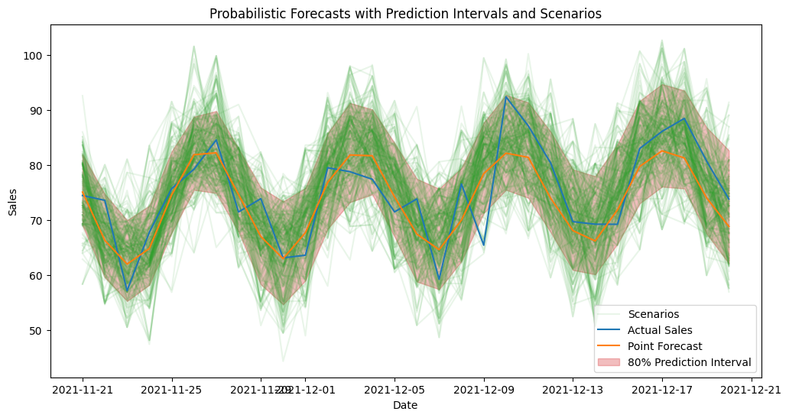
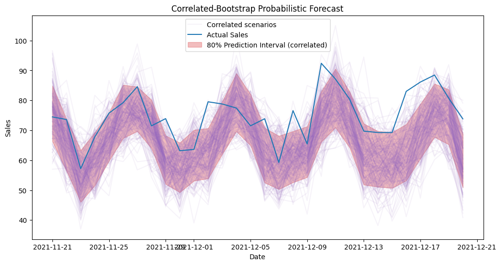

<!-- WARNING: THIS FILE WAS AUTOGENERATED! DO NOT EDIT! -->

## Probabilistic Forecasting

peshbeen provides native support for probabilistic forecasting, allowing
users to obtain not only point forecasts but also prediction intervals
and full forecast scenarios across all model families — naive baselines,
ETS, native ARIMA, Auto ARIMA, GLMs, ML regressors, and regime-switching
models.

For any model in the library, prediction intervals are generated by
calibrating the model’s residuals on a held-out calibration set, then
using those calibrated residuals to simulate future paths of the series
— giving a realistic picture of forecast uncertainty rather than a
single optimistic trajectory.

peshbeen supports four calibration methods: empirical bootstrapping,
correlated error bootstrapping, KDE-based sampling, and
distribution-free conformal prediction. The first three support both
prediction intervals and scenario generation; conformal prediction is
accessed directly via
`.prediction_intervals(coverage=..., conformal=True)`.

``` python
import pandas as pd
import numpy as np
from peshbeen.transformations import fourier_terms
date_range = pd.date_range(start='2020-01-01', periods=720, freq='D')
# create a non-stationary arbitrary flower sales data with an upward trend, weekly seasonality, and yearly seasonality
np.random.seed(42)
data = 30 + 0.07 * np.arange(720) + 10 * np.sin(2 * np.pi * date_range.dayofyear / 7) + 10 * np.sin(2 * np.pi * date_range.dayofyear / 365) + np.random.normal(0, 5, 720)

sales_data = pd.DataFrame(data, index=date_range, columns=['sales'])
sales_data['day_of_week'] = sales_data.index.dayofweek

fourier_trms = fourier_terms(index=sales_data.index, period=365, num_terms=2)
sales_data = sales_data.merge(fourier_trms, left_index=True, right_index=True) # merge the fourier terms with the original data to be used as exogenous variables in the model

# split the data into train and test
train = sales_data.iloc[:-30]
test = sales_data.iloc[-30:] # drop the target column from the exogenous variables for the test set
cat_vars = ['day_of_week']

from peshbeen.models import ml_forecaster
from peshbeen.probabilistic_forecasting import prob_forecasts
from sklearn.linear_model import LinearRegression
from sklearn.preprocessing import OneHotEncoder
ohe = OneHotEncoder(drop='first', sparse_output=False, handle_unknown="ignore")

# lets use our sales_exog dataset to generate probabilistic forecasts using the linear regression model we fitted with fourier terms as exogenous variables. We will use the bootstrapping method to generate prediction intervals and forecast scenarios, which will allow us to capture the uncertainty in our forecasts and provide a range of possible future outcomes based on the variability in the historical data. This approach is particularly useful for decision-making and risk assessment, as it gives us insights into the potential variability in future sales rather than just a single point forecast. We will then visualize the prediction intervals and scenarios to better understand the uncertainty around our forecasts.
# first create a model instance with the same specifications as the one we used to generate point forecasts, but without fitting it yet
lr_model = ml_forecaster(model=LinearRegression(),
              target_col='sales', lags = 7, cat_variables=cat_vars, categorical_encoder=ohe)
lr_model.fit(train)
lr_forecast = lr_model.forecast(H=30, exog=test.drop(columns=['sales'])) # generate point forecasts for the test set using the fitted linear regression model with fourier terms as exogenous variables
prob_model = prob_forecasts(model=lr_model, H=30, n_calibration=150, step_size=1, random_state=42)
## Generate 1000 forecast scenarios using the KDE-based sampling method, which will allow us to capture the uncertainty in our forecasts and provide a range of possible future outcomes based on the variability in the historical data. We will use the exogenous variables from the test set to generate these scenarios, which will help us understand how different future paths of the series can evolve given the uncertainty in the data and the model.
prob_samples = prob_model.sample(df=train, n_samples=1000, method="empirical", future_exog=test.drop(columns=['sales'])) # empirical method, which generates forecast scenarios by sampling from the empirical distribution of the residuals, allowing us to capture the variability in the historical data and provide a range of possible future outcomes based on that distribution. By using the exogenous variables from the test set, we can also account for any future changes in those variables that may impact the forecasts, providing a more realistic picture of potential future scenarios.
# other options for method are "kde" and "correlated" for both prediction intervals and scenarios; conformal prediction (via calibrate() + conformal_quantiles()) is for prediction intervals only. Each method has its own assumptions and characteristics, so it's recommended to try different methods to see which one captures the uncertainty in the forecasts better for your specific dataset and use case.
# prob_samples = prob_model.sample(df=train, n_samples=1000, method="kde", future_exog=test.drop(columns=["sales"]))   # KDE-based sampling
# prob_samples = prob_model.sample(df=train, n_samples=1000, method="correlated", future_exog=test.drop(columns=["sales"]))   # correlated (cross-horizon) bootstrap
```

``` python
scenarios_df = prob_samples.sample_paths_df
scenarios_df.head()
```

<div>
<style scoped>
    .dataframe tbody tr th:only-of-type {
        vertical-align: middle;
    }
&#10;    .dataframe tbody tr th {
        vertical-align: top;
    }
&#10;    .dataframe thead th {
        text-align: right;
    }
</style>

<table class="dataframe" data-quarto-postprocess="true" data-border="1">
<thead>
<tr style="text-align: right;">
<th data-quarto-table-cell-role="th"></th>
<th data-quarto-table-cell-role="th">h_1</th>
<th data-quarto-table-cell-role="th">h_2</th>
<th data-quarto-table-cell-role="th">h_3</th>
<th data-quarto-table-cell-role="th">h_4</th>
<th data-quarto-table-cell-role="th">h_5</th>
<th data-quarto-table-cell-role="th">h_6</th>
<th data-quarto-table-cell-role="th">h_7</th>
<th data-quarto-table-cell-role="th">h_8</th>
<th data-quarto-table-cell-role="th">h_9</th>
<th data-quarto-table-cell-role="th">h_10</th>
<th data-quarto-table-cell-role="th">...</th>
<th data-quarto-table-cell-role="th">h_21</th>
<th data-quarto-table-cell-role="th">h_22</th>
<th data-quarto-table-cell-role="th">h_23</th>
<th data-quarto-table-cell-role="th">h_24</th>
<th data-quarto-table-cell-role="th">h_25</th>
<th data-quarto-table-cell-role="th">h_26</th>
<th data-quarto-table-cell-role="th">h_27</th>
<th data-quarto-table-cell-role="th">h_28</th>
<th data-quarto-table-cell-role="th">h_29</th>
<th data-quarto-table-cell-role="th">h_30</th>
</tr>
</thead>
<tbody>
<tr>
<td data-quarto-table-cell-role="th">0</td>
<td>70.203125</td>
<td>68.211784</td>
<td>61.222973</td>
<td>47.457646</td>
<td>81.232649</td>
<td>77.495237</td>
<td>87.476730</td>
<td>71.192629</td>
<td>67.034386</td>
<td>60.305736</td>
<td>...</td>
<td>85.838524</td>
<td>75.784002</td>
<td>69.753410</td>
<td>69.731598</td>
<td>72.669514</td>
<td>79.870773</td>
<td>93.659278</td>
<td>88.009088</td>
<td>87.464328</td>
<td>74.435822</td>
</tr>
<tr>
<td data-quarto-table-cell-role="th">1</td>
<td>78.691134</td>
<td>74.740641</td>
<td>61.016970</td>
<td>83.559826</td>
<td>90.572751</td>
<td>87.953672</td>
<td>96.814063</td>
<td>79.939854</td>
<td>64.572440</td>
<td>68.788660</td>
<td>...</td>
<td>74.970377</td>
<td>72.838277</td>
<td>68.561255</td>
<td>64.933742</td>
<td>77.445978</td>
<td>67.482043</td>
<td>91.776537</td>
<td>91.707965</td>
<td>76.203132</td>
<td>75.481506</td>
</tr>
<tr>
<td data-quarto-table-cell-role="th">2</td>
<td>82.069878</td>
<td>61.770775</td>
<td>67.900598</td>
<td>67.495120</td>
<td>69.749580</td>
<td>79.239796</td>
<td>79.836127</td>
<td>66.879103</td>
<td>66.755009</td>
<td>66.691565</td>
<td>...</td>
<td>87.017650</td>
<td>64.417982</td>
<td>75.878479</td>
<td>80.253700</td>
<td>79.177897</td>
<td>83.927480</td>
<td>84.239859</td>
<td>69.757712</td>
<td>78.160331</td>
<td>66.422037</td>
</tr>
<tr>
<td data-quarto-table-cell-role="th">3</td>
<td>80.346174</td>
<td>66.091816</td>
<td>61.401799</td>
<td>62.789824</td>
<td>72.857167</td>
<td>83.558991</td>
<td>80.061408</td>
<td>81.668895</td>
<td>72.644718</td>
<td>67.219090</td>
<td>...</td>
<td>76.933844</td>
<td>69.719599</td>
<td>61.166186</td>
<td>64.933742</td>
<td>68.640012</td>
<td>87.175191</td>
<td>81.238305</td>
<td>91.028212</td>
<td>69.380568</td>
<td>75.335512</td>
</tr>
<tr>
<td data-quarto-table-cell-role="th">4</td>
<td>66.752091</td>
<td>64.230679</td>
<td>62.686489</td>
<td>67.053262</td>
<td>67.114281</td>
<td>83.131232</td>
<td>77.014338</td>
<td>61.557219</td>
<td>69.843805</td>
<td>53.361732</td>
<td>...</td>
<td>78.910478</td>
<td>70.907761</td>
<td>81.000763</td>
<td>74.934948</td>
<td>66.045678</td>
<td>90.214074</td>
<td>83.649049</td>
<td>88.001431</td>
<td>85.495248</td>
<td>72.394421</td>
</tr>
</tbody>
</table>

<p>5 rows × 30 columns</p>
</div>

``` python
# we can also generate prediction intervals from the generated scenarios using the sample_quantiles attribute of the prob_samples object, which gives us the quantiles of the simulated forecast paths and allows us to visualize the uncertainty around our forecasts in the form of prediction intervals.
prediction_intervals = prob_samples.sample_quantiles(quantiles=[0.1, 0.9])
prediction_intervals.head()
```

<div>
<style scoped>
    .dataframe tbody tr th:only-of-type {
        vertical-align: middle;
    }
&#10;    .dataframe tbody tr th {
        vertical-align: top;
    }
&#10;    .dataframe thead th {
        text-align: right;
    }
</style>

<table class="dataframe" data-quarto-postprocess="true" data-border="1">
<thead>
<tr style="text-align: right;">
<th data-quarto-table-cell-role="th"></th>
<th data-quarto-table-cell-role="th">point_forecast</th>
<th data-quarto-table-cell-role="th">q_0.10</th>
<th data-quarto-table-cell-role="th">q_0.90</th>
</tr>
</thead>
<tbody>
<tr>
<td data-quarto-table-cell-role="th">h_1</td>
<td>75.106952</td>
<td>69.030466</td>
<td>81.959195</td>
</tr>
<tr>
<td data-quarto-table-cell-role="th">h_2</td>
<td>66.339791</td>
<td>59.629132</td>
<td>74.740641</td>
</tr>
<tr>
<td data-quarto-table-cell-role="th">h_3</td>
<td>62.027001</td>
<td>55.311825</td>
<td>69.990028</td>
</tr>
<tr>
<td data-quarto-table-cell-role="th">h_4</td>
<td>64.862720</td>
<td>58.261351</td>
<td>72.619318</td>
</tr>
<tr>
<td data-quarto-table-cell-role="th">h_5</td>
<td>74.599564</td>
<td>67.703653</td>
<td>82.487477</td>
</tr>
</tbody>
</table>

</div>

``` python
# lets visualize the prediction intervals and 15 scenarios from the generated probabilistic forecasts to understand the uncertainty around our forecasts and the range of possible future outcomes based on the variability in the historical data. This visualization will help us see how the forecasted values can vary and provide insights into potential risks and opportunities for decision-making.
import matplotlib.pyplot as plt
plt.figure(figsize=(12, 6))
# plot 201 scenarios
for i in range(200):
    plt.plot(test.index, scenarios_df.iloc[i], color='C2', alpha=0.1)
plt.plot(test.index, scenarios_df.iloc[100], color='C2', alpha=0.1, label='Scenarios') # added for labeling the scenarios in the legend
plt.plot(test.index, test['sales'], label='Actual Sales', color='C0')
plt.plot(test.index, lr_forecast, label='Point Forecast', color='C1')
# plot the prediction intervals we generated from the scenarios
plt.fill_between(test.index, prediction_intervals["q_0.10"], prediction_intervals["q_0.90"], color='C3', alpha=0.3, label='80% Prediction Interval')
plt.title('Probabilistic Forecasts with Prediction Intervals and Scenarios')
plt.xlabel('Date')
plt.ylabel('Sales')
plt.legend()
plt.show()
```



One concern with bootstrapping residuals is that it assumes the
residuals are independent and identically distributed (i.i.d.), which
may not hold in time series data where residuals can exhibit
autocorrelation. To address this, peshbeen offers correlated error
bootstrapping, which preserves the temporal dependence structure of the
residuals by resampling blocks of consecutive residuals rather than
individual residuals. This method may provide more accurate prediction
intervals and scenarios when there is significant autocorrelation in the
residuals.

Also, KDE-based sampling allows for a non-parametric estimation of the
residual distribution, which can capture more complex patterns in the
residuals compared to simple bootstrapping. This can lead to more
accurate and realistic forecast scenarios, especially when the residuals
exhibit non-normality or heteroscedasticity.

To obtain probabilistic forecasts via correlated error bootstrapping and
KDE-based sampling, user can simply pass `method="correlated"` or
`method="kde"` to the `sample` method of the
[`prob_forecasts`](https://mustafaslanCoto.github.io/peshbeen/modules/prob_forecast.html#prob_forecasts)
object, along with the training and future exogenous variables if
applicable.

### Conformal Prediction

Conformal prediction is a powerful technique for generating valid
prediction intervals without making strong assumptions about the
underlying data distribution. This method is particularly useful when
the residuals do not follow a normal distribution or when there is
heteroscedasticity in the data, as it provides robust and reliable
prediction intervals based on the empirical distribution of the
residuals. As conformal prediction does not rely on bootstrapping or
density estimation, it does not support scenario generation, but it can
be a valuable tool for obtaining accurate prediction intervals.

We can call `.prediction_intervals(coverage=0.80, conformal=True)`
directly after `.calibrate(df)` to obtain distribution-free conformal
prediction intervals based on the empirical nonconformity scores from
the calibration set. Because conformal prediction calculates
nonconformity quantiles analytically without stochastic simulation,
there is no need to call `.sample()` first.

``` python
from xgboost import XGBRegressor
xgb_model = ml_forecaster(model=XGBRegressor(n_estimators=100, max_depth=5, random_state=42),
              target_col='sales', lags = 7, box_cox=0.5)
# xgb_model.fit(train_exog)
prob_model = prob_forecasts(model=xgb_model, H=30, n_calibration=150, step_size=1, random_state=42)
# 
prob_model.calibrate(df=train)
conformal_predictions = prob_model.prediction_intervals(coverage=0.80, conformal=True, future_exog=test.drop(columns=['sales']))
conformal_predictions.head()
```

<div>
<style scoped>
    .dataframe tbody tr th:only-of-type {
        vertical-align: middle;
    }
&#10;    .dataframe tbody tr th {
        vertical-align: top;
    }
&#10;    .dataframe thead th {
        text-align: right;
    }
</style>

<table class="dataframe" data-quarto-postprocess="true" data-border="1">
<thead>
<tr style="text-align: right;">
<th data-quarto-table-cell-role="th"></th>
<th data-quarto-table-cell-role="th">point_forecast</th>
<th data-quarto-table-cell-role="th">lower_80</th>
<th data-quarto-table-cell-role="th">upper_80</th>
</tr>
</thead>
<tbody>
<tr>
<td data-quarto-table-cell-role="th">h_1</td>
<td>71.317757</td>
<td>62.417804</td>
<td>80.217710</td>
</tr>
<tr>
<td data-quarto-table-cell-role="th">h_2</td>
<td>69.481117</td>
<td>60.303101</td>
<td>78.659133</td>
</tr>
<tr>
<td data-quarto-table-cell-role="th">h_3</td>
<td>62.339542</td>
<td>54.274463</td>
<td>70.404622</td>
</tr>
<tr>
<td data-quarto-table-cell-role="th">h_4</td>
<td>58.300976</td>
<td>49.698848</td>
<td>66.903104</td>
</tr>
<tr>
<td data-quarto-table-cell-role="th">h_5</td>
<td>59.909595</td>
<td>51.724596</td>
<td>68.094595</td>
</tr>
</tbody>
</table>

</div>

> What if there isn’t enough data to set aside a separate calibration
> set? In that case, in-sample residuals can be used instead — but with
> an important caveat: since the model is evaluated on the data it was
> trained on, the resulting prediction intervals will likely be
> optimistic, underestimating true forecast uncertainty. This is
> particularly true when the model overfits, as in-sample residuals will
> not fully reflect the variability the model will encounter on unseen
> data. That said, it is a practical and computationally efficient
> option when data is limited, as it avoids holding out any observations
> from training.

> Note that correlated error bootstrapping is not available for
> in-sample residuals, as its procedure relies on horizon-dependent
> error structure that cannot be derived from in-sample fit alone.

``` python
from sklearn.linear_model import Lasso
lr_model = ml_forecaster(model=Lasso(alpha=0.1, random_state=42),
              target_col='sales', lags = 21, box_cox=0.5)
prob_model_insample = prob_forecasts(model=lr_model, H=30, n_calibration=None, random_state=42) # Just leave n_calibration as None to use the training data for calibration
prob_samples = prob_model_insample.sample(df=train, n_samples=1000, method="kde", future_exog=test.drop(columns=['sales'])) # generate in-sample forecast scenarios using the KDE-based sampling method, which will allow us to capture the uncertainty in our forecasts and provide a range of possible future outcomes based on the variability in the historical data. By using the exogenous variables from the test set, we can also account for any future changes in those variables that may impact the forecasts, providing a more realistic picture of potential future scenarios.

prob_samples.sample_quantiles(quantiles=[0.1, 0.9]).head()
```

<div>
<style scoped>
    .dataframe tbody tr th:only-of-type {
        vertical-align: middle;
    }
&#10;    .dataframe tbody tr th {
        vertical-align: top;
    }
&#10;    .dataframe thead th {
        text-align: right;
    }
</style>

<table class="dataframe" data-quarto-postprocess="true" data-border="1">
<thead>
<tr style="text-align: right;">
<th data-quarto-table-cell-role="th"></th>
<th data-quarto-table-cell-role="th">point_forecast</th>
<th data-quarto-table-cell-role="th">q_0.10</th>
<th data-quarto-table-cell-role="th">q_0.90</th>
</tr>
</thead>
<tbody>
<tr>
<td data-quarto-table-cell-role="th">h_1</td>
<td>73.441562</td>
<td>64.790065</td>
<td>80.433520</td>
</tr>
<tr>
<td data-quarto-table-cell-role="th">h_2</td>
<td>67.889286</td>
<td>59.237789</td>
<td>74.881244</td>
</tr>
<tr>
<td data-quarto-table-cell-role="th">h_3</td>
<td>63.400497</td>
<td>54.749000</td>
<td>70.392455</td>
</tr>
<tr>
<td data-quarto-table-cell-role="th">h_4</td>
<td>65.285133</td>
<td>56.633636</td>
<td>72.277091</td>
</tr>
<tr>
<td data-quarto-table-cell-role="th">h_5</td>
<td>71.037142</td>
<td>62.385645</td>
<td>78.029100</td>
</tr>
</tbody>
</table>

</div>

### Correlated (cross-horizon) bootstrap in action

The `empirical` and `kde` methods resample residuals independently at
each horizon, which can understate the *joint* uncertainty of a
multi-step path. The `correlated` method instead fits a multivariate
normal to the full H-dimensional residual vectors, so a sample path that
is high at horizon 1 tends to stay high at horizon 2 — preserving the
horizon-to-horizon dependence that matters for downstream simulation
(e.g. cumulative demand over a week). Below we regenerate scenarios with
`method="correlated"` and overlay the interval.

``` python
# Re-use the calibrated linear model from the start of the notebook.
corr_samples = prob_model.sample(df=train, n_samples=1000, method="correlated",
                                 future_exog=test.drop(columns=['sales']))

corr_scenarios = corr_samples.sample_paths_df
corr_intervals = corr_samples.sample_quantiles(quantiles=[0.1, 0.9])

plt.figure(figsize=(12, 6))
for i in range(200):
    plt.plot(test.index, corr_scenarios.iloc[i], color='C4', alpha=0.08)
plt.plot(test.index, corr_scenarios.iloc[0], color='C4', alpha=0.08, label='Correlated scenarios')
plt.plot(test.index, test['sales'], label='Actual Sales', color='C0')
plt.fill_between(test.index, corr_intervals["q_0.10"], corr_intervals["q_0.90"],
                 color='C3', alpha=0.3, label='80% Prediction Interval (correlated)')
plt.title('Correlated-Bootstrap Probabilistic Forecast')
plt.xlabel('Date')
plt.ylabel('Sales')
plt.legend()
plt.show()
```



### Probabilistic forecasting for multivariate models

The same machinery works for wide multivariate forecasters
([`var`](https://mustafaslanCoto.github.io/peshbeen/modules/02_models/var.html#var),
[`ms_var`](https://mustafaslanCoto.github.io/peshbeen/modules/02_models/ms_var.html#ms_var),
[`ml_multi_output_forecaster`](https://mustafaslanCoto.github.io/peshbeen/modules/02_models/multi_output.html#ml_multi_output_forecaster))
through
[`mv_prob_forecasts`](https://mustafaslanCoto.github.io/peshbeen/modules/prob_forecast.html#mv_prob_forecasts).
It automatically models the joint cross-target residual covariance
across all `target_cols` and returns sample paths, quantiles, and
prediction intervals for every target variable simultaneously:

``` python
from peshbeen.models import var
from peshbeen.probabilistic_forecasting import mv_prob_forecasts
from sklearn.preprocessing import OneHotEncoder
import numpy as np
import pandas as pd

# Build a small multivariate dataset (sales / marketing / advertising).
np.random.seed(0)
mv_index = pd.date_range(start='2020-01-01', periods=600, freq='D')
doy = mv_index.dayofyear.to_numpy()
mv = pd.DataFrame({
    'sales':       120 + 0.1*np.arange(600) + 5*np.sin(2*np.pi*doy/7) + np.random.normal(0, 2, 600),
    'marketing':    80 + 0.07*np.arange(600) + 3*np.sin(2*np.pi*doy/7) + np.random.normal(0, 2, 600),
    'advertising':  50 + 0.03*np.arange(600) + 1*np.sin(2*np.pi*doy/7) + np.random.normal(0, 2, 600),
}, index=mv_index)
mv['day_of_week'] = mv.index.dayofweek
mv_train, mv_test = mv.iloc[:-30], mv.iloc[-30:]

mv_ohe = OneHotEncoder(drop='first', sparse_output=False, handle_unknown="ignore")
mv_model = var(target_cols=['sales', 'marketing', 'advertising'],
               lags={'sales': 7, 'marketing': [1, 7], 'advertising': 5},
               cat_variables=['day_of_week'], categorical_encoder=mv_ohe)

# Joint probabilistic forecast across all target series.
mv_prob = mv_prob_forecasts(model=mv_model, H=30,
                            n_calibration=100, step_size=1, random_state=42)
mv_samples = mv_prob.sample(df=mv_train, n_samples=500, method="empirical",
                            future_exog=mv_test[['day_of_week']])
mv_samples.sample_quantiles(quantiles=[0.1, 0.5, 0.9])['sales'].head()
```

<div>
<style scoped>
    .dataframe tbody tr th:only-of-type {
        vertical-align: middle;
    }
&#10;    .dataframe tbody tr th {
        vertical-align: top;
    }
&#10;    .dataframe thead th {
        text-align: right;
    }
</style>

<table class="dataframe" data-quarto-postprocess="true" data-border="1">
<thead>
<tr style="text-align: right;">
<th data-quarto-table-cell-role="th"></th>
<th data-quarto-table-cell-role="th">point_forecast</th>
<th data-quarto-table-cell-role="th">q_0.10</th>
<th data-quarto-table-cell-role="th">q_0.50</th>
<th data-quarto-table-cell-role="th">q_0.90</th>
</tr>
</thead>
<tbody>
<tr>
<td data-quarto-table-cell-role="th">h_1</td>
<td>180.183076</td>
<td>177.521032</td>
<td>179.951139</td>
<td>182.971572</td>
</tr>
<tr>
<td data-quarto-table-cell-role="th">h_2</td>
<td>178.358964</td>
<td>175.013161</td>
<td>178.025878</td>
<td>181.916386</td>
</tr>
<tr>
<td data-quarto-table-cell-role="th">h_3</td>
<td>175.423334</td>
<td>172.678381</td>
<td>175.513780</td>
<td>178.482534</td>
</tr>
<tr>
<td data-quarto-table-cell-role="th">h_4</td>
<td>173.129286</td>
<td>170.213467</td>
<td>172.945356</td>
<td>176.137950</td>
</tr>
<tr>
<td data-quarto-table-cell-role="th">h_5</td>
<td>175.573579</td>
<td>172.391140</td>
<td>175.205654</td>
<td>179.867011</td>
</tr>
</tbody>
</table>

</div>

### Probabilistic forecasting for multi-series panel models

Just as
[`mv_prob_forecasts`](https://mustafaslanCoto.github.io/peshbeen/modules/prob_forecast.html#mv_prob_forecasts)
handles joint multivariate models
([`var`](https://mustafaslanCoto.github.io/peshbeen/modules/02_models/var.html#var),
[`ms_var`](https://mustafaslanCoto.github.io/peshbeen/modules/02_models/ms_var.html#ms_var)),
[`multi_prob_forecasts`](https://mustafaslanCoto.github.io/peshbeen/modules/prob_forecast.html#multi_prob_forecasts)
provides native probabilistic calibration and scenario generation for
**multi-series panel models**
([`panel_forecaster`](https://mustafaslanCoto.github.io/peshbeen/modules/02_models/panel_forecast.html#panel_forecaster),
[`ml_multi_forecaster`](https://mustafaslanCoto.github.io/peshbeen/modules/02_models/ml_multi_forecast.html#ml_multi_forecaster)).

It calibrates residuals across the pooled panel and returns sample
paths, quantiles, and prediction intervals for **every individual series
ID** in the dataset:

``` python
from peshbeen.datasets import load_sales
from peshbeen.models import panel_forecaster
from peshbeen.probabilistic_forecasting import multi_prob_forecasts
from lightgbm import LGBMRegressor

# Load panel sales data and pick a subset of series
df = load_sales()
stores = ['store_01_item_01', 'store_01_item_02']
df_sub = df[df['store_item'].isin(stores)].copy()
train = df_sub[df_sub.index <= '2025-12-31']
test = df_sub[df_sub.index >= '2026-01-01']

panel_model = panel_forecaster(
    model=LGBMRegressor(n_estimators=30, random_state=42, verbose=-1),
    id_col='store_item',
    target_col='sales',
    lags=[1, 7]
)

# Calibrate and sample across all panel series
multi_prob = multi_prob_forecasts(model=panel_model, H=7, n_calibration=20, step_size=1)
multi_prob.calibrate(train)
fc_samples = multi_prob.sample(train, n_samples=100, method='empirical')

# Prediction intervals are returned for each series ID
intervals = fc_samples.prediction_intervals(coverage=0.80)
for s in stores:
    print(f"Prediction intervals for {s}:")
    print(intervals[s].head(3))
```

    Prediction intervals for store_01_item_01:
         point_forecast   lower_80    upper_80
    h_1       83.412492  78.551066   95.009170
    h_2       88.368297  83.151056   98.448565
    h_3       87.898978  82.913488  101.991645
    Prediction intervals for store_01_item_02:
         point_forecast    lower_80    upper_80
    h_1      123.061217  116.913210  134.793520
    h_2      123.061217  121.023674  132.891812
    h_3      120.568807  118.433357  132.259794
