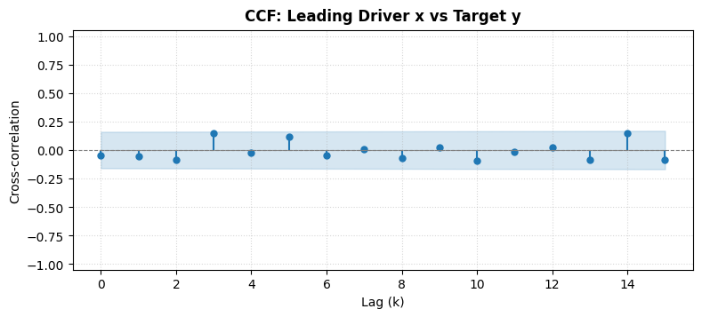

# Statistical Plots (`statsplots`)


<!-- WARNING: THIS FILE WAS AUTOGENERATED! DO NOT EDIT! -->

## Cross-Correlation Function (CCF) Plotting

[`plot_ccf`](https://mustafaslanCoto.github.io/peshbeen/modules/statplots.html#plot_ccf)
(and alias `ccf_plot`) visualizes the sample cross-correlation between
two time series *x*<sub>*t*</sub> (e.g., exogenous driver) and
*y*<sub>*t*</sub> (e.g., target series) across multiple forward lags,
along with statistical confidence intervals.

- **Parametric Figure Sizing**: Fully customizable `figsize`.
- **Confidence Bands**: Lag-adjusted ($z / \sqrt{n-k}$) or fixed
  white-noise ($z / \sqrt{n}$) bands.
- **Composable**: Accepts an optional `ax` parameter to embed within
  custom matplotlib figures.

------------------------------------------------------------------------

<a
href="https://github.com/mustafaslanCoto/peshbeen/blob/main/peshbeen/statsplots.py#L50"
target="_blank" style="float:right; font-size:smaller">source</a>

### plot_ccf

``` python
def plot_ccf(
    x:ArrayLike, # First time series (e.g. predictor or input series x_t).
    y:ArrayLike, # Second time series (e.g. target or output series y_t).
    lags:int=20, # Number of forward lags to compute and plot (lags 0 through lags).
    alpha:float=0.05, # Significance level for confidence intervals (e.g. 0.05 for 95% CI).
    adjusted:bool=True, # If True, uses lag-specific adjusted CI (z / sqrt(n - k));
    # if False, uses fixed white-noise CI (z / sqrt(n)).
    figsize:tuple[float, float]=(10, 4), # Figure dimensions (width, height) in inches. Ignored if `ax` is provided.
    title:str | None=None, # Custom title for the plot. If None, defaults to "Cross-Correlation Function (CCF)".
    ax:plt.Axes | None=None, # Target matplotlib axes to draw on. If None, a new figure is created.
    color:str='#1f77b4', # Color for stem markers and lines.
)->plt.Axes: # The axes object containing the CCF plot.
```

*Plot the sample cross-correlation function (CCF) between two time
series.*

``` python
# Example: Plot CCF for a single pair of time series
np.random.seed(42)
x_series = np.random.normal(size=150)
y_series = np.roll(x_series, 2) + 0.3 * np.random.normal(size=150)

ax = plot_ccf(x_series, y_series, lags=15, figsize=(9, 3.5), title="CCF: Leading Driver x vs Target y")
assert ax is not None
plt.show()
```



## Multi-Pair Cross-Correlation Plots

[`plot_ccf_pairs`](https://mustafaslanCoto.github.io/peshbeen/modules/statplots.html#plot_ccf_pairs)
automates the visualization of cross-correlations across multiple
candidate predictor features against a primary target time series in a
clean subplot grid.

------------------------------------------------------------------------

<a
href="https://github.com/mustafaslanCoto/peshbeen/blob/main/peshbeen/statsplots.py#L143"
target="_blank" style="float:right; font-size:smaller">source</a>

### plot_ccf_pairs

``` python
def plot_ccf_pairs(
    data:pd.DataFrame | dict, # Dataset containing multiple time series.
    target:str | ArrayLike | None=None, # Target variable (y_t). If `data` is a DataFrame and `target` is a string,
    # computes CCF between each predictor column and `target`.
    predictors:Sequence[str] | None=None, # List of predictor column names to evaluate against `target`.
    # If None, all other columns in `data` are treated as predictors.
    lags:int=20, # Number of lags to compute for each pair.
    alpha:float=0.05, # Significance level for confidence intervals.
    adjusted:bool=True, # Whether to use lag-adjusted confidence intervals.
    ncols:int=2, # Number of subplot columns in the figure grid.
    figsize:tuple[float, float] | None=None, # Overall figure dimensions (width, height). If None, calculated automatically based on subplots.
    color:str='#1f77b4', # Color for stem markers and confidence bands.
)->tuple[plt.Figure, np.ndarray]: # The created figure and array of axes.
```

*Plot CCF subplots across multiple pairs or multiple predictors against
a target series.*

## Autocorrelation (ACF) and Partial Autocorrelation (PACF) Plots

[`plot_acf_pacf`](https://mustafaslanCoto.github.io/peshbeen/modules/statplots.html#plot_acf_pacf)
provides a versatile diagnostic plotting interface for time series
serial dependence.

### Key Capabilities:

- **Flexible Diagnostics**:
  - `kind="both"`: Plots both ACF and PACF.
  - `kind="acf"`: Plots ACF only.
  - `kind="pacf"`: Plots PACF only.
- **Layout Control**:
  - `layout="horizontal"`: Places ACF and PACF side-by-side (1 × 2).
  - `layout="vertical"`: Stacks ACF above PACF (2 × 1).
- **Multi-Series Batch Plotting**: Pass a single Series, a dictionary, a
  list of series, or a multi-column DataFrame to generate diagnostic
  rows for each series in one unified figure.
- **Parametric Controls**: Custom `lags`, `figsize`, `alpha`
  significance levels, and `zero` lag toggle.

------------------------------------------------------------------------

<a
href="https://github.com/mustafaslanCoto/peshbeen/blob/main/peshbeen/statsplots.py#L246"
target="_blank" style="float:right; font-size:smaller">source</a>

### plot_acf_pacf

``` python
def plot_acf_pacf(
    series:ArrayLike | pd.DataFrame | dict, # Time series data to analyze (single 1D series, list of series, or multi-column DataFrame).
    lags:int=30, # Number of lags to compute and display.
    kind:Literal['both', 'acf', 'pacf']='both', # Which diagnostic plot(s) to generate.
    layout:Literal['horizontal', 'vertical']='horizontal', # Subplot orientation when `kind="both"`.
    # - "horizontal": ACF and PACF side-by-side (1 row, 2 columns per series).
    # - "vertical": ACF stacked above PACF (2 rows, 1 column per series).
    alpha:float=0.05, # Significance level for confidence interval bands.
    zero:bool=False, # Whether to include lag 0 in the plots. Default False focuses on informative lags >= 1.
    pacf_method:str='ywm', # Estimation method for PACF calculation ('ywm', 'ywadjusted', 'ols', 'ld').
    figsize:tuple[float, float] | None=None, # Dimensions (width, height) of the figure. If None, calculated automatically.
    title:str | None=None, # Custom figure/subplot title or prefix.
    ax:plt.Axes | np.ndarray | None=None, # Pre-existing axes to draw on (single series only).
    color_acf:str='#1f77b4', # Color for ACF stem plot and confidence intervals.
    color_pacf:str='#ff7f0e', # Color for PACF stem plot and confidence intervals.
)->tuple[plt.Figure, Union[plt.Axes, np.ndarray]]: # Figure and axes object(s).
```

*Plot Autocorrelation Function (ACF), Partial Autocorrelation Function
(PACF), or both.* Supports single or multiple time series.
